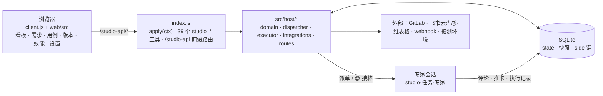

# dsh-studio

[](https://github.com/marsken88/dsh-studio/actions/workflows/ci.yml)
[](https://www.npmjs.com/package/@marsken/dsh-studio)
[](https://www.npmjs.com/package/@marsken/dsh-studio)
[](LICENSE)


给一家公司用的「需求&任务工作空间」：一个常驻的 DSH 插件，把**看板 + 角色 agent + 内部市场**装进 DSH Web 的同一个页面里。
自建 GitLab 管代码、飞书管交流，agent 负责产品 / 架构 / 研发 / 测试四个角色的具体活儿。

运行环境：DSH `0.2.2-rc.1`，Node 22 以上，Linux/macOS（Windows 原生不支持 `link:` 安装 + systemd 托管）。

维护：供应链数字化组。有问题在本仓库开 issue，或直接找看板里的「产品」；发版流程见 [docs/publish.md](docs/publish.md)。

## 它是怎么跑的



一句话：**浏览器只认 `/studio-api`；状态全在 SQLite；专家是 DSH 会话，写回来的东西也落 SQLite；外部系统只被平台调用。**

## 它长什么样

| 工作台：今天该做什么、谁在忙 | 看板：八列、角色负责人、卡片带进度/用例 |
| --- | --- |
|  |  |

| 卡片抽屉：状态 / 清单 / 用例 / 执行记录 | 需求：基线、变更影响面、可追溯矩阵 |
| --- | --- |
|  |  |

| 用例库：跨卡聚合、套件、最近回归 | 效能：一次通过率、返工率、按专家 + token 成本 |
| --- | --- |
|  |  |

| 版本：发布、灰度、部署记录 | 设置·测试执行：执行开关、数量上限、出站 webhook |
| --- | --- |
|  |  |

| 设置·成本与预算：价目表（元/百万 token） | 设置·专家：8 位专家、模型与提示词 |
| --- | --- |
|  |  |

截图不是手截的：`npm run shots`（`tools/visual/capture.mjs`）会登录面板、逐个页签截一遍，顺手断言没有「渲染失败」。

## 部署

仓库：https://github.com/marsken88/dsh-studio（`main` 分支，含可直接安装的构建产物 `client.js`，clone 下来就能装，不用先构建）。

```bash
# 1) 拉到宿主机
# 1) 拉到本机任意目录
git clone https://github.com/marsken88/dsh-studio.git ~/dsh-studio

# 2) 装进目标 profile（会写 profile 的 package.json + bundles，走 pnpm link）
dsh plugin --profile web add link:~/dsh-studio

# 3) 确认挂载
dsh --profile web --dump-config | grep -A2 'dsh-studio'

# 4) 重启服务
sudo systemctl restart dsh-web
```

页面入口：DSH Web 左侧栏第 4 项「需求&任务工作空间」。三个页签：**看板 / 市场 / 设置**。

## 质量闸门

两类 HTML/CSS 抓不到的回归，现在由构建期守卫和真库自检挡住：

| 命令 | 挡什么 |
| --- | --- |
| `cd web && npm run guard` | CSS 里写回 `hsl(var(--x))`（颜色解析失败）、Radix Portal 忘记 `container={portalRoot()}`（弹层「存在但不可见」）、产物丢失门户作用域属性 |
| `npm run smoke:store -- ~/.dsh/dsh-studio.db` | 用生产库的 `.db/-wal/-shm` 副本在本地跑真实启动路径，抓「空库能起、真库就炸」的 `ReferenceError` |
| `npm test` | 102 条契约：manifest、产物哈希、宿主接口、跨模块导入、只读绑定赋值、迁移与文档一致性、门禁纯函数、快捷键解析 |

`pnpm build` 已串上守卫（`make-legacy → guard --pre → vite build → sync-client → guard --post`），CI 也会跑：忘记构建或写出上面两类样式，流水线直接红。

## 门禁链（从澄清到发布）

平台不是「拖过去就算完」：每一步都有东西看着，**拦的只有必须在场的东西，其余一律只提示**——提示多了会被无视，拦多了会被绕过。

| 阶段 | 检查 | 拦不拦 |
| --- | --- | --- |
| 澄清 | 三问必答（有没有服务端 / 鉴权谁做 / 交付边界） | **拦**：答不完拆不了卡 |
| 拆卡 | 说有后端，但功能点没有一条讲接口 / 数据表 / 鉴权 | 提示 |
| 拆卡 | 说没有后端，功能点却要建表 / 写接口 | 提示 |
| 拆卡 | 功能点没有验收标准（长不出用例） | 提示 |
| 卡准出 | 清单没勾完 / 有用例失败 / 卡被标阻塞 / 没人签字 | **拦**（`override` 可强推，须写原因并留痕） |
| 需求准出 | 没有产品输出 / 评审没过 / 有待确认问题 / 卡没完成 / 卡在阻塞 / 缺陷未关 / 用例失败 / **一条跑过的用例都没有** / 没签字 | **拦** |
| 需求准出 | **卡上没有产品/架构专家的讨论**（只有自动跑用例的汇总）、RICE 没打分、功能点没被通过用例覆盖、**有用例没跑过**、**有用例被标跳过**、**「通过」是手标的没有执行记录**、**有卡是强推的**、没有交付物 | 提示 |
| 发布 | tag 名、关联卡、冒烟清单 | **拦** |

> 需求签字前会先算准出门禁；确实要提前签就传 `override` 写一句原因，原因会出现在需求准出里——**逃生舱可以开，但要留痕**。
> 新加一条门禁或一条体检，必须同时进 `npm run selfcheck`（连跑三轮的闭环断言），否则它只是写在代码里的建议。
## 更多文档

| 想了解 | 看这里 |
| --- | --- |
| 登录与免登录（LDAP / 本地超管 / 会话落库） | [docs/auth.md](docs/auth.md) |
| 界面实现（shadcn 对齐 / 构建链 / 布局一致性 / 暗色巡检） | [docs/ui.md](docs/ui.md) |
| 第一天上手（三条命令，全新 clone 验过） | [docs/quickstart.md](docs/quickstart.md) |
| 发版到插件市场 | [docs/publish.md](docs/publish.md) |
| 宿主接口依赖与升级 runbook | [docs/compatibility.md](docs/compatibility.md) |
| 过程记录（按日期的实现流水账） | [docs/history.md](docs/history.md) |
| 每个版本改了什么 | [CHANGELOG.md](CHANGELOG.md) |

## 开发与兼容性

- 参与开发（构建链、部署、验证要求、禁区）：[AGENTS.md](AGENTS.md)
更新日志（每版改了什么、有哪些已知限制）：[CHANGELOG.md](CHANGELOG.md)
上手第一天（三条命令，已在全新 clone 上验证过）：[docs/quickstart.md](docs/quickstart.md)
发布到插件市场（npm / GitHub 发版 + 收录条目 + 自查清单）：[docs/publish.md](docs/publish.md)
- 依赖的 dsh 宿主接口、升级 runbook、兼容矩阵与已知限制：[docs/compatibility.md](docs/compatibility.md)

## 看板

建卡与建需求的入口在页面右上角统一成一个「＋ 新建」：菜单里选「新建需求」进需求表单，选「新建任务」直接在看板上开一张卡（详见文末「新建入口合并」）。

想找东西不用一页页翻：按 **⌘K / Ctrl+K** 打开全局搜索，输编号、标题或负责人，↑↓ 选、回车直达（卡片直接开抽屉，需求跳到需求页并选中，版本跳到版本页）。

最常用的三件事还给了全局快捷键，不用先打开面板：**Ctrl/⌘+Alt+Shift+N** 新建需求、**Ctrl/⌘+Alt+Shift+T** 新建任务、**Ctrl/⌘+Alt+Shift+D** 把某张卡派给专家——按下去面板直接进到对应那一步（选卡 / 选专家），面板已开着时按另一个键会就地切换动作。为什么是这一档：Ctrl+Shift 被浏览器占了（无痕窗口 / 重开标签页 / 收藏所有标签页），而 Ctrl+Alt 被 dsh 宿主占了（Ctrl+Alt+N = 新会话），两层都不能碰。

搜得到的对象：卡片、需求、版本、**专家、专家团、项目、技能库里的技能**（连技能描述与标签一起搜，回车直达设置里的技能库）。

还有五条**带参数的动作**——选完动作会进入第二层选择，Esc 逐层返回。最近用过的动作会自动排到最前面（最多记 6 条，存在浏览器本地）：

| 动作 | 流程 |
| --- | --- |
| 把卡片推进到下一列 | 选一张卡 → 按状态顺序推进一列（已到最后一列会提示），完成后自动打开这张卡的抽屉 |
| 推进并留言 | 选一张卡 → 写一句话 → 这句话进讨论、卡片同时推进一列（交接常用） |
| 整列推进 | 选一列 → 确认一次 → 这一列的卡按顺序一起推进到下一列，逐张汇报成功与失败 |
| 忘掉最近用过的动作 | 清空这台电脑上记的「最近用过」顺序，面板回到默认排序 |
| 把卡片派给专家 | 选一张卡 → 选一位专家，当场跑起来 |
| 给卡片留言 | 选一张卡 → 写一句话，落到卡片讨论里 

同一个框也能**直接办事**（结果前面带紫色「操作」标签）：新建需求 / 新建任务、打开任意页签、导出任务或需求 CSV、切换主题（明亮 / 深色 / 跟随系统）、刷新数据，以及**直接跳到设置里的任意一页**（输入「技能库」「飞书机器人」「权限」等）。

**每列先渲染 40 张卡**，超出的折成一行「显示更多（还有 N 张）」，点一次加 40——卡多的时候先卡住的是浏览器 DOM，不是服务端。

八列，每列的负责人（专家或专家团）可在「设置 → 每一列由谁负责」里改；卡片进入某列时负责人随之切换，并自动派给它。也可以把某列设成「👤 等人认领」——卡停在这一列、不自动派，由人在卡上点名让谁做（默认「待澄清」就是这一档，因为澄清需求本来就不一定是产品经理的活）：

| 列 | id | 默认负责人 |
| --- | --- | --- |
| 待澄清 | `clarify` | 等人认领 |
| 待方案 | `design` | 架构 |
| 待开发 | `dev_ready` | 研发 |
| 开发中 | `dev` | 研发 |
| 待评审 | `review` | 架构 |
| 待测试 | `test` | 测试 |
| 待验收 | `accept` | 产品 |
| 已完成 | `done` | 产品 |

**待评审这一列是给代码评审用的**：研发提了 MR 后，同步任务会把 MR 关联到卡上（`gitlabMR`），只要 MR 还是 `opened` 且卡在「开发中」，就自动把卡推进到「待评审」并派给架构师；评审通过才放行到「待测试」，不通过就 @ 研发退回「开发中」。

卡上显示的「负责：」只看一处：正在跑的那个专家 > 卡上指派的专家 > 本列负责人 > 「未指派」。详情页的「当前列 / 负责」跟卡片用同一套口径，不会再出现「卡片说产品、点开说架构」。

**卡片上直接看得出它挂在哪**（2026-11-09 补）：

| 卡片上的元素 | 含义 | 点击行为 |
| --- | --- | --- |
| `DEV-001` 等编号 | 这条需求下自动分配的编号 | —— |
| `📄 REQ-2026-001`（紫色） | 所属需求；鼠标悬停显示需求标题 | 看板只看这条需求下的卡（再点一次取消） |
| `ORD`（蓝色） | 所属业务项目（项目的代号） | 看板只看这个项目下的卡（再点一次取消） |
| `🗓 2026-11` | 所属迭代（悬停显示起止日期） | —— |

没挂需求的卡显示一枚虚线灰 chip「未挂需求」（点一下直接开卡片去「计划」里挂），所以「卡片上为什么没有需求」这件事本身也是可读的，不再是空白。

**一列可以有多个候选人，靠策略挑一个**：在「设置 → 列的负责人」里给某列「＋ 加候选」加第二个人，列就从单人变成候选池，并出现策略下拉：

| 策略 | id | 怎么挑 |
| --- | --- | --- |
| 轮询 | `round_robin` | 谁手上正在跑的卡少给谁（默认） |
| 按专长匹配 | `best_match` | 同领域 +50、角色位对得上 +20、技能词命中标题/需求 每个 +5，同分再比谁活少 |
| 团长分派 | `lead` | 池子里有专家团就先把卡交给团长，由团长拆活分给成员 |

单人列就是「池子里只有一个人」，行为与以前完全一致。候选池挑出来的人如果没有领域归属、而这张卡标了业务领域，会再自动改派给同领域的对应角色。

**「阻塞」不是一列，是卡上的标记**：卡干不下去时打标（必须写原因），它留在原列、不再被自动派单，看板上红边 + ⛔ 标提示；工具栏有「只看阻塞 N」筛选。之后由人决定怎么继续——交回本列负责人、直接推进到下一列、改派给指定专家，或只解除先不派。任何一次「推进到别的列」都等同于解除阻塞。

卡片字段：标题、类型、当前角色、状态、优先级、需求描述、GitLab Issue 链接、产出物、评论、历史。

点卡片打开右侧详情抽屉（`Esc` 或右上角 × 关闭）。抽屉是「头部固定 + 中间可滚 + 底部评论固定」的三段结构：中间 `.ds-dw-body` 带 `min-height:0`，内容再长也是内部滚动，**不会再把底部评论框顶到屏幕外**（这是早前「详情显示不完整」的根因：flex 子项默认不收缩，body 长过视口后把 footer 挤出去了）。

## 专家与专家团

「设置 → 专家」是这家公司的 AI 员工名册，每个专家有：图标、名字、一句话定位、**角色位**、**业务领域**、**角色提示词**（作为系统提示）、**技能**、模型、Agent 预设、启用开关。

- 默认四位：产品经理、架构师、开发工程师、测试工程师，可按项目增删改（最多 80 个）。
- **按业务领域拆分**：填「业务领域」后可以点「生成产品/架构/研发/测试」一次建出这条业务线的四位专家；卡片上也可以标领域，当某列的负责人是通用专家而卡有领域时，会自动改派给同领域、角色位匹配的那位专家。
- **名字就是 @ 名**：评论里写 `@架构师 请给出方案`，服务端解析出被点名的人并立刻派活，不用等卡片换列。接口返回 `mentions` / `dispatched`，界面显示「已通知 …」。
- 角色提示词会拼进该专家的系统提示，写清楚「先读 README 与 docs/」「不确定先去代码里找证据」这类规矩最有效。
- **新增/编辑走右侧抽屉**：点「新增专家」或行内的「编辑」，表单从右侧滑出（宽 760px，窄屏铺满），左栏名册保持可见；抽屉里「头部标题固定 / 中间表单可滚 / 底部保存栏固定」，`Esc` 或点遮罩关闭。角色提示词和技能列表都比较长，抽屉比原来的内联表单更适合边看名册边改一个人。
- **图标是选出来的，不是打的**：抽屉里给 32 个候选 emoji（角色类 + 业务类），点一下就换上、实时预览；下面还有一个输入框可以粘自定义 emoji，留空回落到 🧩。图标会出现在卡片、评论头像、专家列表与派单会话标题 `[图标 名字]` 上。
- **同一套抽屉用在五处**：专家、专家团、技能库、代码仓库、飞书机器人 的「新增 / 编辑」都是同一个 `SideDrawer` 组件（`client.js` 里的共享组件），行数与按钮位置一致；项目与迭代、列负责人、权限、数据备份这些仍然用内联面板（它们没有「选中一行再编辑」的语义）。

### 键盘可达性（2026-11-09）

面板里很多可点的是 `div` / `span`（卡片、chip、页签、列表行），原生不可聚焦。没有去改几百处调用点，而是在 DOM 层补：

- 启动时（以及 `MutationObserver` 监听到增删后 200ms 去抖）扫一遍 `[data-dsh-studio]` 子树，凡是 `getComputedStyle(el).cursor === 'pointer'` 的元素，补 `tabindex="0"`、`role="button"`、`data-kb="1"`，并绑 `keydown`：`Enter` / 空格 等价于点击。
- `aria-pressed` 跟着 `data-on` 同步（选中态能被读屏念出来），`aria-label` 取 `title` 或文本（截 80 字）。
- 跳过输入框/按钮/链接/`contenteditable` 和遮罩层（`.ds-side-mask` 这类），避免把表单和无障碍语义弄乱。
- 焦点可见：`[data-dsh-studio] :focus-visible { outline:2px solid var(--ds-accent); outline-offset:2px; }`。
- 代价是手足无措时的「隐形 tab 停点」会变多，但换来的是全键盘可用；要收窄范围只需在 `KB_TAG_SKIP` / `keyboardPatch` 的白名单里加类名。

### 显示模式：明亮 / 黑暗 / 跟随系统（2026-11-09）

页头右上角、名字按钮右边是三段式开关 `☀ 明亮` / `☾ 黑暗` / `跟随系统`：

- **只换一套变量，不逐条改样式**：整套配色从一组表面色变量派生（`--ds-bg` 页面底 / `--ds-surface` 面板与卡片 / `--ds-surface-2` 列与次级块 / `--ds-line` 线 / `--ds-shadow` 投影），两套主题各自赋值，其余线条与浅底仍靠 `color-mix(in srgb, currentColor N%, transparent)` 自动算。明亮：`#eef1f5` 底 / `#ffffff` 面板 / `#dbe1ea` 线；黑暗：`#0e1014` 底 / `#181b22` 面板 / `#1e222a` 次级块 / `#2c323d` 线 / `#e6e8ee` 字 / `#7ba2ff` 强调色。
- **层次是「底 < 次级 < 表面」**（2026-11-09 调过）：原来浅色底是 `#fbfbfc`、面板 `#ffffff`，两者差 2%，整页看着一片白、卡片和背景分不开；现在浅色底压到 `#eef1f5`，并给面板/卡片/KPI 加了 1px 投影（`--ds-shadow`），深色下也是「近黑底 + 稍亮面板 + 更亮列底」。看板列用 `--ds-surface-2`、卡用 `--ds-surface`，卡才浮得起来。
- **选择记在浏览器里**：`localStorage['dsh-studio:theme']`，刷新、关标签页再回来都还在；非法值回落到 `跟随系统`。
- **跟随系统先跟宿主**：面板长在宿主页面里，只看操作系统的 `prefers-color-scheme` 会出现「宿主白、工作区黑」的接缝。所以 `跟随系统` 先读宿主 `document.body` 的实际背景亮度（`hostScheme()`），宿主没给出明确信号才退回 `matchMedia`；两条路径都监听变化（`change` 事件 + 1.5s 轮询），不用刷新。
- 换肤范围是工作空间面板本身（`[data-dsh-studio]` 子树）；宿主 GUI 自己的侧栏与顶栏不受插件控制，仍按宿主主题走——所以「强制黑暗 + 宿主是浅色」时，只有工作区这一块变深，这是浏览器里能做到的边界。
- 深色下单独调过的两处：`需求变更被驳回` 的红色 chip 从 `#a3282b` 提到 `#ff9a9d`，否则在 `#14161b` 上几乎看不见；浅色下则压到 `#b3282c` 保证对比度。
- **不要用系统颜色关键字（2026-11-09 修的坑）**：抽屉和弹窗原来写的是 `color:CanvasText`、`--ds-surface:Canvas`。`Canvas`/`CanvasText` 跟的是**操作系统**的深浅色，不是我们自己的 `data-theme`——系统是深色时 `CanvasText` 是白字，用户选「明亮」后抽屉就是白底白字，看板详情、专家编辑全都看不见内容。现在改成 `color:inherit` + `--ds-surface:#ffffff`，文字颜色只跟 `data-theme` 走；同时给两套主题加了 `color-scheme:light|dark`，`<select>`、`<input>`、滚动条这些原生控件才会跟着我们的主题画，而不是跟着系统画。

「设置 → 专家团」把若干专家编成一支队伍（团长 + 成员，最多 12 人）：

- 团长负责拆活、给成员派活、汇总结论；成员之间用 `@对方名字` 接棒。
- 一列可以交给一个专家团，卡片进列时由团长接第一棒。
- 团队协作靠评论里的 @ 流转：`@架构师` → 架构师回复并 `@开发工程师` → 研发接手，每一步都有会话与评论记录。

## 技能库（skills-manager）

「设置 → 技能库」是这家公司的可复用做法库，每条技能有：技能名（kebab-case）、什么时候该用、补充触发条件、标签、Markdown 正文、启用开关。

- **落盘即生效**：保存时会写 `<DSH_HOME>/skills/<名字>/SKILL.md`（默认 `~/.dsh/skills/…`），DSH 的技能文件系统提供方会扫描这个目录，所以任何 agent 都能用 `skill` 工具加载它——不是只存在面板里的一段文本。
- **专家挂技能**：在「专家」表单里点技能库的 chip 就能挂上；派单时提示词会写「你可以使用的技能：<名字>（<用途>）」，让专家知道去加载哪条。
- **专家能自己管理技能**：运行时可用 `studio_skill_list` / `studio_skill_get` / `studio_skill_save` / `studio_skill_delete` 读写技能库。摸出来的做法（命令、坑、检查清单）用 `studio_skill_save` 存下来，下次别的专家直接能用。
- **上传技能**：面板上「上传技能」接受单个 `SKILL.md`（`.md` / `.markdown` / `.txt`）或包含 `SKILL.md` 的 `.zip` 技能包，走 `POST /studio-api/skills/upload`。
  - 名字优先级：frontmatter `name:` → 文件名 → 首行 `# 标题` → 哈希；frontmatter 里的 `description` / `whenToUse` / `tags` 都会带进库，正文取 `---` 之后的部分。
  - 同名默认**拒绝**（不静默覆盖），勾上「覆盖同名技能」才会替换；上传成功后立即落盘，列表里能看到「N 位在用」。
  - `.zip` 由系统 `unzip` 解包，只取包内任意层级的 `SKILL.md`，其余文件不入库；服务器没有 `unzip` 时会给明确提示让人改传 `.md`。
  - 单文件上限 1.4MB（正文本身截断到 6 万字），失败信息都是可读中文（空文件、坏 zip、名字不合法、同名冲突）。
- 「重新写入磁盘」用于把库里所有启用的技能重新刷一遍文件（例如有人手删了 `~/.dsh/skills`）。
- 服务启动时也会自动 sync 一次，库里的技能不会因为磁盘被清理而消失。

## 自动派单（专家 agent）

在「设置 → 自动派单」里打开开关，并勾选**哪些列**自动派单（默认 待方案 / 待开发 / 待测试）。

- 派单实现：一卡一会话（`studio-<taskId>-<专家id>`），会话由 `ctx.agents.create()` 建出来 —— 只有它带驱动循环，`agent.followup()` 才能真正唤醒一轮 turn。
- 会话必须显式给 `agentOptions.provider/model`，否则首轮直接报 `has no provider/model` 退出。
- 会话的工具来自 `agentPresets.resolve(id)` + `mount(scope, id)` 的 `setup` 回调；只写 `meta.agentPreset` 不会挂工具（会话里只剩看板工具）。
- 并发上限 `maxConcurrent`（1–8），槽位在 agent idle 时释放。
- 卡片抽屉里另有「马上处理 / 停止」，用于手动补派或在跳过自动列的卡上手动触发。

角色模型在「设置 → 角色与模型」里配，也可以在「设置 → 专家」里给单个专家指定模型，优先级：专家模型 → 角色模型 → 宿主默认。支持 `provider/model` 或裸模型名（裸名借用默认 provider）。

## GitLab 联动（多项目）

「设置 → GitLab 项目」可以加任意多个仓库，每行配：名称、项目路径（`group/project`）、服务器地址、Access Token（`api` 权限）、只同步的标签、是否自动同步。

- 服务器地址与 Token 留空时回落到全局值（同一台 GitLab 的多个项目只需填一次 Token）。
- 「测试」按钮单独验证某个仓的连通性；「立即同步」只同步该仓，也可以点全局的「全部同步一次」。
- 拉取 open Issue 建卡，按 `(项目, iid)` 去重；每仓各自记录 `lastSyncAt` / `lastSyncError`，互不影响。
- 「每分钟自动同步」按仓开关；卡片状态变化时，会往**这张卡的来源仓**写一条 Issue note（如 `需求&任务工作空间：待方案 → 待开发（架构）`）。

## 飞书联动（多机器人）

「设置 → 飞书机器人」可以加多个群机器人（飞书群 → 添加机器人 → 自定义机器人，拿 Webhook）：

- 每个机器人有：名称、Webhook、**收哪些事件**（卡片状态变化 / 缺陷 SLA 超时 / 自动开缺陷 / 版本发布，可多选）、启用开关。
- 群按需订阅：研发群只勾「自动开缺陷 + SLA 超时」，产品群只勾「版本发布 + 状态变化」，就不会互相刷屏；一项都不勾等于这个群静默（仍可用「测试」发一条自检消息）。
- 老机器人（改造前建的）默认四类全收，与之前的行为一致；`notifyOnChange: false` 的只关掉「状态变化」这一类。
- 「发一条测试消息」可以只测某一个，也可以全部测一遍。
- 自建应用 App ID / App Secret / chat_id 字段保留，用于后续做多维表格镜像。
- 现在会推的消息：卡片状态变化（含「阻塞 / 解除阻塞」）、缺陷 SLA 超时升级、集成通道连续失败、**用例失败自动开出的新缺陷**、**版本发布（含强制发布原因）**。正文统一走 `feishuText()`，字符串和 `{ text }` 两种写法都能正确落到群里（以前会发成 `[object Object]`）。

## 内部市场

「市场」页维护公司自己的插件目录：显示名 + 包名/路径（npm spec 或 `link:/abs/path`）+ 说明。
安装/卸载都委派给 `dsh plugin --profile <本 profile> add|remove`，因此 pnpm lockfile 与 profile 的 bundle 列表保持一致。

- 安装成功后需要**重启 DSH Web** 才会加载新插件（界面会提示）。
- 卸载按包名执行；目录条目里是 `link:` 路径时会回读该目录的 `package.json` 拿包名。

## 需求对象与统一编号

需求是整条链路的锚点，`需求` 页就是它的工作台。

- 需求编号按年递增：`REQ-2026-001`。挂到需求下的卡按类型各自递增：`DEV-001`、`TEST-001`、`BUG-001`、`DES-001`、`OPS-001`，未挂需求的卡没有编号。
- 需求的字段：标题、正文、业务项目/迭代、负责人、优先级、状态（草稿/进行中/已交付/已关闭）、PRD / 原型 / 验收标准链接。
- **需求明细按 Markdown 渲染并完整展示**（2026-11-09）：右侧「需求明细」面板用和评论、交付物同一套 `renderMarkdown`（标题/列表/粗体/代码块/表格/引用都认），不再塞进 180px 的滚动框里截断；编辑表单的正文框改成 10 行，placeholder 里写了支持的语法，功能点的描述也一样按 Markdown 渲染。
- 需求页右侧一眼看到：这张需求下有多少卡、几阻塞、几个未结缺陷、验收清单完成度、用例通过率、交付物与 MR 数量，以及每张卡当前在哪个列、谁在处理。
- 卡片抽屉里会显示 `编号` 与 `所属需求`，反向也能从一张卡追回需求。

## 文档与基线（评审通过才生效）

需求详情里有「文档与基线」：每份 PRD / 原型 / 验收标准都能登记版本（`v1.0`、`v1.1`…）与正文。

- 点「设为基线」= 这一版评审通过、正式生效；同一时间只有一份基线，需求从「草稿」自动转「进行中」。
- 基线会把当时的正文**快照下来**，之后有人改文档不会影响已经生效的版本。
- **基线可以逐行对比**（2026-11-13）：基线框里点「对比基线」，拿最新一篇 PRD 和基线正文做行级 diff，绿加红减、标题行给出 `+N 行 / −M 行`；纯前端计算，不改任何数据，超过 800 行只给整体说明，避免卡页面。
- 基线之后新建的卡会记下 `reqBaseline`（版本 + 时间 + 标题），所以「这张卡是照哪一版做的」永远查得到。
- 「从链接拉正文」会调服务器上的 `lark-cli` 取飞书文档正文（`lark-cli docs +fetch --doc <链接> --doc-format markdown`）；本机已装 1.0.99 并绑定了 CLI 应用（bot 身份即可读）。标题栏为空时会把文档标题自动填进去。服务器没装或应用没被加进文档协作者时，页面会如实显示原因，改成手动粘贴即可。
- 注意：飞书文档里**内嵌的多维表格**在 Markdown 里只有 `<sheet token=…>` 占位，正文能全量拿到，表格要单独按 token 读。

## AI Coding 执行记录（谁照着哪版改了什么）

研发这一棒不能只留一句「做完了」。每张卡上有一份执行记录，用来回答审计问题：**用了什么 Coding Agent、哪个模型、在哪个分支、改了哪些文件、单测跑成什么样、谁评审、谁合并**。

- 研发 agent 改完代码调 `studio_task_coding`（action=update）登记 `agent` / `model` / `branch` / `context`（依据的基线版本或方案）/ `commits` / `files` / 单测总数与通过数；人也可以在抽屉里「手动补录执行记录」。
- 评审时架构师调 `studio_task_coding`（action=review）写 `approved` 或 `changes_requested` + 说明；抽屉里也有「评审通过 / 要求修改」按钮。
- 合入后 action=merge 记下谁合的、什么时候合的。
- 抽屉里的「AI Coding 执行记录」会显示一行摘要（agent · 模型 · 分支 · 单测 x/y · 评审结论）、提交列表、改动文件（新增绿边/修改橙边/删除红边），卡片上显示 `⌥ 文件数`。
- 项目页与 `/metrics` 的 `coding` 指标汇总：有执行记录的卡数、改动文件总数、单测数量与通过数、评审通过数、已合并数。
- 卡片是按基线开的，提示词里会带 `reqBaseline`，所以「评审时看的代码是不是照最新 PRD 写的」可以直接对照。

## 缺陷自动闭环（用例失败 → 缺陷 → 回归）

缺陷不是人工另建的一种「任务类型」，而是自动化测试的直接产物。

- 测试同学在卡上用 `studio_task_case`（或抽屉里的「测试用例」）登记用例并回填 `pass` / `fail` / `skip`。
- **任何一条用例被判 `fail`，服务端立刻自动开一张缺陷卡**：挂同一条需求（编号 `BUG-00n`）、同一个项目/迭代/业务领域，`parent` 指向这张测试卡，`bugSource` 记下是哪条用例、期望、实际结果、谁判的。测试卡上同时留一条评论，缺陷卡上带「复现：执行 TEST-001 的用例 …」。
- 同一条用例重复判失败**不会重复建卡**，只在原缺陷卡上追加一条「用例再次失败」的评论。
- 缺陷卡修好推进到「待测试」时，**平台自动把来源用例重置为 `pending`** 并写「回归中（BUG-00n 已修复待验证）」，测试只需复跑这一条；两边都会收到系统评论。
- 抽屉的「其它信息」里，测试卡显示「关联缺陷」（编号 + 当前列），缺陷卡显示「来源用例」（编号 · 用例 · 判失败时间 · 谁判的）。
- 测试环节的提示词也改了：明确告诉测试 AI「判 fail 会自动建缺陷，不要手工再建一张」，缺陷卡进测试列时会告诉它该复跑哪一条。

## 产物归档到飞书云盘（每个需求一个文件夹）

产物不是留在卡片里的一段文字，而是落进飞书云盘、能被同事直接打开的文件。

- 根文件夹由「设置 → 飞书机器人 → 云盘归档」里的「云盘根文件夹」决定（默认指向公司共享的 `项目需求&缺陷`）。
- **新建需求时自动在根文件夹下建一个同名文件夹**，命名是 `<编号> <标题>`，例如 `REQ-2026-001 会员积分抵扣`；已经建过的直接复用，不会重复建。
- 每件交付物（`studio_task_artifact` 登记的 requirement / design / mr / cases / report / release …）都可以带一段 **Markdown 正文**；登记后平台把它写成文件夹里的一个 `.md` 文件，命名 `<卡片编号>-<类型>-<标题>.md`，并把文档链接回写到交付物上。
- **同名交付物再次归档是覆盖，不是新建**：文档 token 不变、链接不变，正文更新到最新，所以「持续更新同一份产物」是默认行为。
- 抽屉「交付物」区块里每行显示文档链接与「归档 / 更新」按钮；需求页有「交付物归档（飞书云盘）」区块，可以一键「归档 N 件交付物」把积压的产物补齐。
- 授权依赖宿主机上的 `lark-cli`（已装在 `/usr/local/bin/lark-cli`）与**用户身份**授权：`lark-cli auth login --domain drive,docs,markdown,wiki`。bot 身份没有云盘权限，不要用 bot 建文件夹。
- 用户 token 约 2 小时、refresh token 7 天；过期后归档会失败并在交付物上记 `doc.error`，重新走一次 `auth login` 即可。
- **没挂需求的卡也能归档**：会归到根文件夹下自动创建的「未挂需求的产物」文件夹（token 缓存在 `state.fallbackFolder`），不再直接报错。
- **正文可以从文件回读**：交付物只填了 `ref`（比如 `docs/xxx.md`）而没填正文时，归档会去工作区把文件内容读出来（≥2MB 的不读、正文截 6 万字），并把读到的正文回写进交付物——所以看板上能看到「正文 N 字」，下次也不必再读盘。
- 抽屉里每行有「正文」按钮，可以就地补写/修改正文，保存后自动重新同步到云盘。
- **用例与验收清单也按需取**（2026-11-13）：`/studio-api/state` 里每张卡只带 `caseSummary`（总数/通过/失败）与 `checkSummary`（已勾/总数），正文在抽屉打开时一次取回（`POST /task/parts`，只读）；卡片上的 `✅ 0/7`、`☑ 0/3` 和需求的用例覆盖率统计都改读计数。
- **评论也不随轮询下发**（2026-11-13）：`/studio-api/state` 里每张卡只带 `commentCount`，正文等抽屉打开时按卡取一次（`POST /task/comments`，只读）。一条讨论动辄几百字，这一项又砍掉整包的 44%。
- **正文不随轮询下发**（2026-11-13）：`/studio-api/state` 里每件交付物只带 `contentLength`，正文等点「阅读 / 正文」时才单独取（`POST /task/artifact` 的 `get` 动作，只读档位）。实测 21 张卡整包从 1.29 MB 降到约 588 KB（-54.5%），其中交付物正文原本占 733 KB；取过一次会缓存在抽屉里，编辑保存后缓存同步更新。
- **缺正文会在看板上报警**：任何交付物正文为空时，卡片底部出现红色「● 缺正文」（呼吸闪烁）、卡片边框转红；工具栏出现「只看缺正文 N」，一键筛出这些卡；抽屉「交付物」区块标题旁显示「● N 件缺正文」，缺正文的那一行整行淡红底并标注「缺正文」。新增产物没写正文时立刻就会亮，不需要手动刷新或点检。

## 测试执行（接口用例真跑，不是只回填结果）

用例不只是一行文字，写成接口调用就能被执行器真跑一遍。

- 一条用例可以带 `http`：`method` + `url`（可选 `headers` / `body` / `expectStatus` / `expectContains` / `timeoutMs`）。相对 url 会拼当前环境的 `baseUrl`。
- 执行器就跑在这台机器上（.218），不依赖外部 CI：测试列专家调 `studio_test_run`，人在抽屉里点「▶ 跑接口用例」或单条用例的 `▶`。
- 环境与安全在「设置 → 测试执行」：环境列表（名字 + baseUrl）、默认环境、单条超时、**允许访问的域名**（支持 `*.example.com`）。域名不在白名单直接判失败，请求根本不会发出去。
- 跑完回写：每条用例的 `result`（pass/fail）、最近执行的 `status / 耗时 / 响应片段`；卡片上留一条执行摘要评论；保留最近 10 次执行记录（`testRuns`）。
- 失败即开缺陷：复用「缺陷自动闭环」的去重逻辑，同一条用例反复失败只追加评论，不会堆卡。
- 边界：第一版只跑 HTTP 接口，不做 UI 自动化与真机设备农场；用例是**同步串行**跑的，几十条会更慢。
- 开跑前会先探一次环境（`probeEnv`）：连不上/超时/域名不在白名单就整批不跑，免得环境没起却记一堆「用例失败」，把需求准出卡住。

### 跨卡用例总览（2026-11-13）

用例仍然挂在卡上，但不用一张张点开才能看全：顶部多了「用例」页签（`POST /studio-api/cases`，只读，每次都从台账现算，不另存一份）。

- 84 条用例摊成一张表：结果（✅ 通过 / ❌ 不通过 / ⬜ 没跑）、标题、所属卡片编号、所属需求、功能点、接口还是手工、优先级、最近一次跑的时间。
- 三个筛选可以叠加：关键字（用例 / 卡片 / 需求 / 功能点）、需求下拉、结果下拉；标题条实时显示「N 条 · 通过 / 不通过 / 没跑」。
- 点任意一行直接打开那张卡的抽屉，接着就能改结果或重跑；行尾的「明细」就地展开期望、最近一次结论、错误与响应片段（`lastError` / `lastPreview` 随 `/cases` 一起下发），不用点进抽屉。
- 卡片上的用例变了（跑了一条、加了一条、生成一批）页面会自动重取；没变化就不重复请求。
- **失败补跑一键到位**：工具栏上有「↻ 只跑上次失败的 N 条」——只挑「上次不通过、且有 http 定义」的用例重跑，没失败时按钮是灰的。修完 bug 的回归就点它，不用再翻列表勾选。
- **批量回归已经能做**：勾几条（或「全选可跑的 N 条」）→「▶ 跑选中的 N 条」，服务端按卡分组、一卡一轮串行跑完，回写各自的卡，再汇总「跑了 X 张卡 / Y 条：通过 a，不通过 b，自动开缺陷 c」；一次最多 60 条。手工用例（没写 `http`）勾不上——跑了也没意义。
- **最近回归留痕**（2026-11-13）：每次批量跑完记一条（时间、谁跑的、几张卡 / 多少条、通过 / 不通过 / 自动开缺陷），保留最近 20 次，列在「用例」页的工具栏下方一行小 chip，有失败的那次标红；夜里定时跑的那批 `by=定时回归`，早上打开页面就知道昨晚跑成什么样。记录放在 SQLite 的 side 键里，不占 state、不涨 revision。
- **跑之前平台自己先探环境**（2026-11-13）：开跑前对 `baseUrl` 发一个请求，连不上就直接回「测试环境「X」不可达（ECONNREFUSED）：一条用例都没跑」，**不会把整批用例刷成失败**。任何 HTTP 响应（含 404/500）都算活着——那是服务在跑，只是接口不对。

## shell 用例（默认关闭）

用例除了打接口，还能跑一条命令并断言结果——补上「单测 / 脚本类」用例长期只能手工回填的缺口。

**打开方式**：设置 → 测试执行 → 打开「允许 shell 用例」（`config.testing.allowShell`）。

> ⚠️ 打开它等于承认：**能打开看板的人可以在宿主机上执行任意命令**。只在信任使用者时开启；默认关闭，关闭时 shell 用例会明确失败并说明原因，不会静默跳过。

| 字段 | 作用 |
| --- | --- |
| `command` | 要跑的命令（必填） |
| `cwd` | 工作目录；留空用设置里的默认值 |
| `timeoutMs` | 超时，默认 30s，上限 120s |
| `expectExit` | 期望退出码，默认 0 |
| `expectContains` / `expectNotContains` | 输出里必须出现 / 不能出现的内容 |

两个入口：卡片抽屉用例区的 **「＋ shell」**（命令 + 期望输出两步录入），或调 `POST /studio-api/task/case` 直接写 `shell: { … }`。

## 数据库用例（默认关闭）

第三种执行方式：对着一个 SQLite 库跑一条语句，断言行数与首行某列的值。适合「库存不能被扣成负数」这类只有查库才能确认的验收。

**打开方式**：设置 → 测试执行 → 打开「允许数据库用例」（`config.testing.allowDb`）。默认**只读**打开，要写入必须显式 `readOnly: false`。

```json
{ "title": "库存不能超卖", "db": {
  "file": "/tmp/test.db",
  "sql": "select count(*) as n from orders where stock < 0",
  "expectRows": 1, "expectColumn": "n", "expectValue": "0" } }
```

| 字段 | 作用 |
| --- | --- |
| `file` / `sql` | 必填；库文件路径与语句 |
| `params` | 绑定参数（`?` 占位） |
| `expectRows` | 期望行数；不填不校验 |
| `expectColumn` + `expectValue` | 校验首行某一列的值 |
| `readOnly` | 默认 `true`；要改数据才设 `false` |

## 出站 webhook（把变化告诉外部系统）

目前发出五种事件——`task/moved`（卡片换列）、`case/failed`（用例失败，flaky 除外）、`gate/blocked`（准出/设计闸门拦住）、`agent/failed`（派单失败）、`regression/finished`（一批用例跑完，含卡数/条数/通过/失败）。配了 webhook 就 POST 出去：

```json
{ "webhooks": [{ "id": "ci", "url": "https://ci.example/hook",
  "events": ["task/moved", "case/failed"], "enabled": true }] }
```

事件长这样：

```json
{ "type": "task/moved", "at": 1794585755429,
  "payload": { "taskId": "t-…", "from": "clarify", "to": "accept", "by": "agent" } }
```

约定三条：**调用方不重试**（外部抖动是常态，事件本身已进台账）、**5 秒超时**、**订阅者之间互不影响**（一个 hook 抛错不影响其它 hook，也不影响正在写库的请求）。

## 数量上限（可配）

以前写死在路由里：一张卡 60 条用例、一次批量跑 60 条、一张卡 40 个交付物——**超了静默丢**。现在读配置，超了会明确报错（套件回归仍然继续跑，但会标记 `truncated`）：

```json
{ "limits": { "casesPerTask": 60, "runKeys": 60, "artifactsPerTask": 40 } }
```

范围 1–500，写非法值会退回默认。

## 用例自动生成（从功能点长出来，不是凭空写）

测试用例不用一条条手敲：需求拆了功能点、每个功能点带验收条件，平台就能照着生成。

- 抽屉「测试」页签点「✨ 按需求生成」→ `POST /task/cases/generate`；agent 侧用 `studio_task_generate_cases`。
- 规则：卡挂了需求、需求里有功能点，就按每条**验收条件**生成一条用例（标题 `验证：条件原文`，期望就是条件本身，`result=pending`）；这条点没有验收条件时退回「验证《功能点标题》主流程」。
- 生成时按标题去重，重复点不会堆一遍；返回 `added / total / reason`，界面会提示「已生成 N 条」或「没生成用例：原因」。
- 生成的用例自动带上 `pointId`，直接进可追溯矩阵的统计口径——生成完就能在需求页看到这条点的覆盖变化。

## 缺陷 SLA 与疑似重复

缺陷有响应时限，重复的缺陷不该开成两张卡。

- SLA 默认按严重级别：`p0` 4 小时、`p1` 24 小时、`p2` 72 小时、`p3` 168 小时；在 `config.sla` 里可改，`bugSla()` 按 `createdAt + hours` 算出 `dueAt`，并给状态 `ok / due_soon / overdue / met / late`。
- 看板卡片上直接显示 `⏰ 剩 Nh`（临近时限变橙、逾期红底白字 `⏰ 逾期 Nh`），悬停能看到应修时间。
- 建缺陷时 `findDuplicateBug()` 会比对「同类型 bug + 未完成 + 标题归一后相同」的卡：命中就把新卡的 `duplicateOf` 指向老卡、加 `疑似重复` 标签，并在老卡上留一条评论指路；人可以在抽屉里改用例把两张合成一张（`POST /task/duplicate`、工具 `studio_bug_duplicate`）。
- 边界：只做标题归一（去 `[用例失败]` 前缀、标点、空格、emoji、大小写），不做语义相似度；也不自动合并，只标出来让人判断。

## 发布 tag 与冒烟清单

发布不只是「记一笔」：要能对上确定的代码，并且冒烟跑过。

- 版本对象新增 `tagName`（发布标签）与 `commitSha`（对应提交，选填），在版本页信息表单里填。
- 「发布冒烟清单」：逐条勾（`x/y 项已过`），走 `POST /release/smoke`（`add / toggle / remove`）。
- 门禁新增两条拦截：**没填发布标签**、**还有 N 项冒烟没过**（列出未过的条目名）。也就是说 tag 不填、冒烟没过，`/release/approve` 与 `/release/publish` 都会被拒。
- 边界：tag 只是记录与校验，平台不会替你打 tag 或推代码；冒烟清单也是人勾，不是自动跑（接口用例另走「测试执行」）。

## 执行成本与提示词版本

- 每位专家的提示词会算一个 `promptVersion`（提示词内容的 sha1 前 8 位），存进专家配置；专家改了提示词，版本号就变。
- 每次派单成功（`deliver` 之后）记一条运行日志：任务、会话、专家、模型、提示词版本、开始时间；会话 settle 时补上结束时间与耗时（`RUN_LOG` 最多留 300 条）。
- `GET /costs`（工具 `studio_costs`）返回总次数、已结束次数、平均耗时，以及按专家 / 按模型 / 按提示词版本 / 按天的次数分布。
- **真实 token 用量（0.1.12 起）**：`GET /costs` 多了 `usage` 段——直接读 `~/.dsh/sessions/*/studio-*/session.v4.jsonl.zstd` 里每次模型调用的 `usage`（入/出/缓存读/缓存写），按卡、按专家汇总。效能页的「AI 执行成本」会显示 `token 用量` 与 `预估花费`。
- 花钱要配价目表（元 / 百万 token，空表只报 token 不报钱）：

  ```json
  { "costs": { "prices": [
    { "model": "deepseek-v4.1-flash", "input": 2, "output": 8, "cacheRead": 0.2 }
  ] } }
  ```

  对账命令：`npm run verify:usage [taskId]`——ssh 取原始日志现算一遍，和 `/costs` 的数字比。

  **实测**（线上 3045 次调用 / 2.42 亿 token）：配价目表后算出 ¥81.47，其中 719 次调用因模型没配价目记「未知」；清空价目表后花费显示 `null`（未知），不会按 0 算。
- 口径见上一节七条；订阅通道（`*-coding` / `*-token-plan`）记 token、不计钱。

### 成本口径（接真实用量之前先定死，免得以后对不上账）

1. **只统计本平台的会话**：`studio-<taskId>-<expertId>`。你自己在 DSH 里开的会话不算，哪怕用的是同一个模型。
2. **订阅套餐通道不计钱，只计 token**：模型 id 以 `-coding` / `-token-plan` 结尾的走订阅额度，成本记 0，token 照记——否则会把"包月"算成"每次都在烧钱"。
3. **按 turn 记，不按会话记**：一次派单可能追加多轮，钱是按 turn 出的。
4. **三级汇总**：卡（taskId）→ 专家（expertId）→ 项目（project）；卡的成本是它所有 turn 之和，专家的是他所有卡之和，项目的是它所有卡之和。
5. **缓存命中要分开记**：命中 cache 的输入 token 单价通常低一个量级，混在一起算会高估。拿不到就标"未知"，不要按 0 算。
6. **价目表跟着日期走**：模型调价后，历史记录按当时单价算，不重算——所以每条记录要存 `{ at, model, inputTokens, outputTokens, cacheHitTokens, unitPrice }`。
7. **拿不到用量就不写 0**：`cost: null` 表示未知，页面显示"未接入/未知"，不能让报表看起来"很便宜"。

## 负载与燃尽（里程碑视图的轻量版）

- `GET /workload`（工具 `studio_workload`）：每位专家 `running / open / done7d / overdue`，外加 `busy` 汇总——谁被压住了、谁闲着，一眼能看出来。
- `GET /burndown?days=14&project=`（工具 `studio_burndown`）：近 N 天每天的 `created / done / remaining` 序列，外加 `now.remaining`；效能页有一排迷你柱状图。
- 效能页新增三块面板：团队负载、燃尽（近 14 天剩余）、AI 执行成本（平均执行时长 + 按模型/提示词版本的次数）。
- 边界：燃尽是「剩余卡数」口径，不是故事点；负载只统计专家会话，不含人。

插件向主会话注册了 34 个 `studio_*` 工具，任何会话都能读写看板：

看板与配置：`studio_config_get` / `studio_config_set` / `studio_task_list` / `studio_task_get` / `studio_task_create` / `studio_task_update` / `studio_task_block` / `studio_task_unblock` / `studio_task_comment`

需求：`studio_requirement_list` / `studio_requirement_get` / `studio_requirement_save` / `studio_requirement_folder`（建/复用需求文件夹并批量归档产物）

交付与验收：`studio_task_artifact`（登记交付物：需求/方案/MR/用例/报告/发布说明）/ `studio_task_check`（勾验收清单，附证据）/ `studio_task_case`（登记测试用例并回填 pass/fail/skip）/ `studio_test_run`（真跑接口用例，失败自动开缺陷）/ `studio_task_coding`（登记 AI Coding 执行记录与评审结论）

项目与技能：`studio_project_list` / `studio_project_save` / `studio_skill_list` / `studio_skill_get` / `studio_skill_save` / `studio_skill_delete`

版本与发布：`studio_release_list` / `studio_release_get` / `studio_release_save` / `studio_release_publish`（门禁不过会被拒，返回逐条拦截原因）

效能：`studio_analytics`（一次通过率、返工率、周期分布、每列停留、AI 产出采纳情况）/ `studio_workload`（团队负载）/ `studio_burndown`（燃尽）/ `studio_costs`（派单次数与时长）

测试与缺陷：`studio_task_generate_cases`（按功能点验收条件生成用例）/ `studio_bug_duplicate`（标记疑似重复缺陷）

专家会话通过系统提示词段（order 70）知道自己的身份、职责、@ 规则与技能库用法，并用同一批工具汇报产出、推进状态、沉淀技能。

## 沙箱与代码隔离（一卡一会话，一卡一 worktree）

两件事是分开的：**沙箱**管「这个会话能碰什么」，**worktree** 管「这个会话在哪写代码」。

### 沙箱（DSH permission preset）

DSH 自带操作系统级沙箱（`dsh-sandbox-local`，Linux 上走 bwrap，退路是 Landlock）。dsh-studio 以前把它写死成 `danger-full-access`，现在可配：

- 「设置 → 自动派单 → 沙箱档位」：`read-only`（能看不能改）/ `workspace-write`（默认，只写自己的工作目录）/ `danger-full-access`（无沙箱，危险）。
- 单个专家可以覆盖：专家表单里的「沙箱档位」，空 = 跟随全局。
- 派单时落到 `permissionPresets.set(agent.session, 档位)`，`.218` 上 `/usr/bin/bwrap` 已装，`workspace-write` 实测能挡住往工作区外写文件（拒绝信息原样出现在 agent 的 bash 结果里）。
- 看当前运行中的会话用了什么档位：`GET /studio-api/agents/policy`。

### git worktree 隔离

「设置 → 自动派单 → 代码隔离 = worktree」后，每张卡有自己的目录与分支：

- 前提：卡挂在**配了「本机代码目录」的业务项目**上（设置 → 项目与迭代 → 本机代码目录 + 基线分支）。
- **一个项目多个服务（2026-11-09）**：项目表单里可以加多条「服务」，每条有 `服务名 / 本机 git 路径 / 基线分支 / 关联 GitLab 仓库`；卡的「计划」里选一个服务，worktree 就从**那个服务的路径**切，基线也用它自己的分支。卡上不选服务时退回项目级「本机代码目录」；老项目（只有项目级目录）会自动折成一个 `默认服务`，行为不变。
- 服务在看板上的样子：卡上多一个 `📦 服务名` chip（鼠标悬停看路径），看板顶部多一个「全部服务 / 某个服务」筛选（跟着项目走），卡详情「其它信息」里有一行「服务」；服务被删掉或改名后，卡上残留的 id 会被后端清成「未指定」，chip 上显示「服务已失效」。
- 服务校验：建卡/改卡时传一个不属于该项目的服务 id，会被**静默清空**（不会让卡挂着一个不存在的路径）；保存项目时删掉某个服务，该项目下所有卡上指向它的 `service` 一并清空。
- 智能体侧：`studio_project_list` 每行列出服务（`服务名→路径`），`studio_project_save` 可以整组写入服务（`services: [{name, repoPath, baseBranch, repoId}]`，部分更新语义）；派单提示词里会写「服务：<名字>（本机代码目录 <路径>，基线分支 <分支>）」。
- 派单时自动 `git worktree add -b task/<编号> <root>/<编号> <基线分支>`，会话的 cwd 就是那个目录，提示词里也写明「只在这个目录里改代码、提交到这条分支」。
- `worktreeRoot` 留空 = 工作区同级目录 `dsh-worktrees`。
- 「卡完成时」选 `on_done` 会自动 `git worktree remove --force` + `git branch -D`；默认 `manual`，留着等人看 diff。
- 抽屉里有「代码隔离」区块：`建 worktree` / `看 git worktree 列表` / `回收 worktree`，也可以走 `POST /studio-api/task/worktree {id, action}`。
- 真机验证（`tools/verify-worktree.mjs`，14/14 PASS）：建卡 → 自动出现 `<workspaceDir>/DEV-001` + 分支 `task/DEV-001` → 主工作区保持干净 → 回收后目录与分支都清掉。
- 多服务验证（`tools/verify-services.mjs`，20/20 PASS）：一个项目挂两个服务（两个真实 git 仓库），卡选服务 B → worktree 只建在 B 的仓库、分支 `task/<编号>` 只存在于 B、A 仓库没有多余 worktree；老项目自动迁移成默认服务；建卡/改卡传非法服务被清空；删掉服务后卡上的 `service` 被清空；回收后配置复原（脚本会先读基线，发现有卡挂着读不到的项目就直接 ABORT，避免用空列表冲掉真项目）。
- **服务依赖（2026-11-09）**：项目表单里每条服务下面多一行「依赖」chip，勾上它依赖的**同项目内**服务（最多 10 条，自己不能依赖自己，互依赖会自动留一条边去环）。规则：被依赖服务的卡没全部完成时，本服务的卡过不了准出——门禁多一条「依赖服务还没完成：<服务>（N 张：卡号/标题）」；派单提示词写「本服务依赖：A、B（这些服务的改动先落地…）」；项目列表行显示「N 条依赖」，任务详情「服务」行也带「依赖 …」。智能体侧 `studio_project_save` 的 `services[]` 支持 `dependsOn: []`。
- 服务依赖验证（`tools/verify-service-deps.mjs`，18/18 PASS）：保存带依赖的项目 → 依赖落库、自依赖丢弃、未知服务丢弃、互依赖只留一条边 → 建上游/下游/无依赖三张卡 → 只有下游卡的门禁出现「依赖服务还没完成」，上游与无关服务不受影响 → 上游推到完成后下游不再被拦（推完成要过门禁，脚本用 `override` 写明原因是「只用来代表上游服务已完成」）。
- 踩过的坑（2026-11-09）：项目编辑面板里引用了未定义的 `services`，一点「编辑 / 迭代」整个工作区就白屏（渲染期抛错会把整棵插件树卸掉，不是局部报错）。修法是 `const services = draft === null ? [] : (draft.services ?? [])`。教训：这类新加的渲染分支，`node --check` 过得去不代表能跑，改完必须真点开一次看。

边界：worktree 只在「本项目本机有 git 仓库」时才有意义；远程仓库、GitLab 上的 MR 仍需 `glab` 或人工推送，平台不替你 push。

## 版本与发布管理（门禁 + 发布说明 + 回滚留痕）

版本是一个独立对象（`~/.dsh/dsh-studio.json` 的 `releases`），卡通过 `releaseId` 挂上去。

- 状态机：`draft` 草稿 → `candidate` 待发布 → `approved` 已审批 → `released` 已发布 → `rolled_back` 已回滚。已发布/已回滚的版本**锁定版本号与状态**，只能通过 `rollback` 改状态。
- **发布门禁**（`releaseGate`）不是给人看的提示，是硬拦截：卡全做完、没有阻塞标记、缺陷全部关闭、没有 `result=fail` 的用例，才允许 `审批通过` 与 `发布`；否则接口返回 `门禁没过：…`。警告（不拦）只看两类：交付物缺正文、整批卡一个交付物都没登记。
- **发布说明自动生成**：按需求/方案/研发/测试/缺陷/运维分组列出 `- 编号 标题`，生成后可以手改，失焦自动保存。
- **回滚**：必须写原因（进复盘记录），只有 `released` 能回滚。
- 三个入口：看板顶部「版本」页签（左清单 + 右详情 + 门禁面板 + 版本内卡片 + 挂卡）、抽屉「计划 → 所属版本」、agent 工具 `studio_release_*`。
- 接口：`GET /releases`（每条带 `gate`）、`POST /release/get|save|delete|link|notes|approve|publish|rollback`。
- 真机验证（`tools/verify-release.mjs`）：**15 项全 PASS** —— 新建默认草稿 → 卡没完成时门禁不通过、审批/发布都被拒 → 卡完成后门禁通过 → 发布成功并记时间 → 发布说明自动汇总 → 回滚不带原因被拒、带原因成功且落库。

## 权限与审计（谁动了什么）

DSH 的 web 只有一张登录 cookie，所有人共用；所以平台自己记「当前身份」：页头 `👤 人` 可以改名字，存在浏览器 `localStorage`，每个请求带 `x-studio-user` 头。

- **成员名单**（设置 → 安全 → 权限与审计）：三个人档——`管理员`（改配置、删数据、发布/回滚、装插件）、`成员`（建卡、推卡、评论、跑用例、登记交付物）、`只读`（只看）。
- **启用成员权限**后：名单里没有的人**还能看板**（避免名字对不上直接锁死），但一个写操作都做不了；成员碰管理员动作会被拒并说明原因。
- 没启用时所有人按管理员算，单机用法完全不变。
- **审计日志**：每个 `POST` 都记一条——时间、谁、动了哪个接口（有中文动作名）、关键字段摘要（id / title / status …，不记正文与密钥）、成功还是失败、HTTP 码。保留最近 1000 条，面板里可只看失败、按人筛、清空。
- 接口：`POST /access/save`（`{enabled?}` / `{member:{name,role}}` / `{agents:'inherit'|'bypass'}`）、`POST /access/delete`、`POST /audit/clear`、`POST /access/explain`（`{sessionId, tool}` → 这个会话调这个工具会被放行还是拦下、为什么）；`GET /state` 里带最近 200 条 `audit`。
- 真机验证（`tools/verify-access.mjs`）：**13 项全 PASS** —— 未启用时谁都能写、名单外人能读不能写、只读成员被拒、成员能建卡但改配置被拒、管理员能改配置、审计确实记下被拒者与成功动作。

### AI 专家也受名单约束（工具层权限）

以前这层只管浏览器面板，专家 agent 走宿主工具、谁也拦不住。现在工具调用也过同一张名单：

- 每个工具分三档：**读**（`studio_task_list` / `studio_task_get` / `studio_config_get` / `studio_analytics` / `studio_skill_get` …）、**写**（建卡、推卡、评论、登记交付物、跑用例、建 worktree，**没登记的工具一律按写处理**）、**管理员**（`studio_config_set`、`studio_release_save`、`studio_release_publish`、`studio_skill_delete`）。
- 调用方身份从会话名解析：派单会话固定是 `studio-<taskId>-<expertId>`，于是能判定「是哪个专家在调」。解析不出时按当前页头身份算。
- 名单里的专家按角色判：只读专家调写工具会被拒，错误里直接写「「架构师」是只读，这一步需要成员权限」。被拒也会进审计（`失败 403`）。
- **启用权限的那一刻会自动把现有专家登记成「成员」**，否则一开权限所有 AI 立刻停工；新加的专家需要自己去名单里补一条。
- 设置 → 权限与审计 里的勾选框 **AI 专家也受这份名单约束**：勾着是 `inherit`（默认），取消是 `bypass`（只记审计不拦，适合「全交给 AI」的团队）。
- 验证（`tools/verify-access2.mjs`，21 项全 PASS）：权限关闭放行、开启自动登记专家、只读专家能读不能写、不能改配置、未登记工具按写判、名单外专家被拦、bypass 放行、恢复成员后可写。

## 集成健康（外部通道坏了要看得见）

飞书通知、GitLab、飞书云盘归档、代码隔离这四条通道，任何一次调用（成功 / 失败 / 跳过）都会记进内存健康表：

- 页头在有条异常时亮红：**⚠ 集成异常 N**，点一下直接跳到「设置 → 集成健康」，鼠标悬停能看到每条错误的原文。
- 「集成健康」页按通道列：状态点、最近一次调用、最近成功、最近失败、连挂次数、错误原文，以及一个 **再试一次** 按钮（GitLab → 立刻同步一次；云盘 → 挑一条带文件夹的需求重新归档；飞书 → 发一条测试消息；代码隔离 → 下次派单自动重试）。
- 判定口径：飞书通知失败会**自动重发一次**（隔 400ms），两次都失败才算异常；飞书 HTTP 200 但 body `code !== 0` 也按失败记；没配 webhook / 没装 lark-cli 记「跳过」，不算异常。
- 接口：`GET /integrations/health` → `{channels:[{channel,label,hint,ok,state,at,lastOkAt,lastErrorAt,lastError,failures,attempts,skipped}], broken, checkedAt}`；`GET /state` 里也有同一份 `integrations`。
- 语义：单条通道失败不会影响别的通道——GitLab 挂了照样能归档交付物，worktree 建失败只让这张卡退回普通工作区。

## 效能分析（过程指标，不是拍脑袋）

**上下文洞察**：效能页底部按专家汇总会话数、上下文窗口峰值（`input + cacheRead` 峰值）、回合数、工具调用、模型重试与最近活动；峰值超 180k 会标「接近上限」。数据直接读 `~/.dsh/sessions` 里的会话日志，不额外花 token（接口 `POST /studio-api/contexts`）。点开某位专家还能看它**最近一次会话的上下文构成**：系统提示 / 工具调用与结果 / 助手输出 / 输入 / 事件元数据各占多少（按日志文本体积估算，约 3 字符/token，是比例不是账目）。**占用率用引擎自己的 `contextWindow`（会话日志 `request/context` 事件，实测 1,000,000）算，不是猜的**。工具结果占比 ≥60% 的行会标「工具占 X%」——那是「上下文是被工具输出撑满的」的信号，该精简的是工具返回值而不是提示词。

看板顶部「效能」页签，数据来自 `GET /analytics?days=7|30|90&project=<id>`，也可以让 agent 用 `studio_analytics` 读。

**版式（2026-11-09 重排，两轮）**：原来是 `repeat(auto-fit,minmax(300px,1fr))`，1180px 宽时四块面板挤一行、每块不到 300px，柱条被压成一条线。现在改成 12 栅格 + 三段分区，并且面板按内容高度排（`align-items:start`），不再为了等高在底部拉出一片空白：

| 分区 | 内容 |
| --- | --- |
| 质量 | 一次通过率 / 返工率 / 中位周期 / AI 交付采纳率；`repeat(4,minmax(0,1fr))`，900px 折两列、560px 折一列，每张卡左侧一条强调条（`box-shadow:inset 3px 0 0`，warn 时变红） |
| 流程与产能 | 左列 `ds-span-4` 上下叠「周期分布」「近 14 天完成」两块小面板，右列 `ds-span-8` 放「每列停留」——8 行列表把这一行填满，左边两块就不会被拉高 |
| 交付、成本与返工 | AI 产出质量 · 团队负载 · 燃尽（各 4 列）+ AI 执行成本（4 列）· 返工最多的卡（8 列） |

- 每块面板底部有一句 `.ds-an-foot` 底注（`margin-top:9px` + 虚线上边框），把「所以呢」写出来：周期分布给均值/中位/P90，每列停留直接点名最慢的一列，燃尽给累计建/累计完成/还剩几张。
- `.ds-an-row` 的列宽从 `84/1fr/64` 放到 `106/1fr/84`，专家名不再折行、右侧数字按列对齐。
- 两个迷你柱图 `.ds-spark` 高 78px、底边一条基线、柱宽 `70%`，日期标签隔天显示（`index % 2 === 0`），14 个标签不再挤成一排。
- 窄屏：`@media (max-width:1180px)` 把 4/5 列的面板折成 6 列（两栏），`(max-width:760px)` 全部一栏。

- **一次通过率**：已完成卡里，从没被退回过（没在任何列倒退过）的比例。低说明需求没想清楚就往下推。
- **返工率**：有一定推进过的卡里，出现过「倒退」（状态在流程里往回走）的比例；同时给出评审打回次数、测试打回次数，以及返工最多的卡（可直接点开）。
- **周期分布**：卡从创建到第一次进「已完成」的时长，按 ≤1 天 / 1–3 天 / 3–7 天 / >7 天分桶，并给中位数、均值、P90（中位数比均值抗极端值）。
- **每列停留**：每种状态的平均停留时长，用来找瓶颈列（比如「待评审」平均卡 2 天，说明评审是瓶颈）。
- **近 14 天完成**：每天完成的卡数迷你柱图，看交付节奏。
- **AI 产出质量**：交付物里由专家登记的比例（按登记人是否命中专家名册判定）、其中被人验收（`accepted`）的比例、缺正文条数；AI Coding 卡的评审通过/要求修改数、单测通过率、已合并数。
- 口径说明：返工只看 `task.history`（每条记的是**进入的新状态**），所以「同一列连续记录」会被合并，只有真正往回走才算倒退；`days` 决定窗口，但在办的卡永远算进来（否则看不到正在卡住的活）。
- 真机验证（`tools/verify-analytics.mjs`）：**16 项全 PASS** —— 造一张「dev → design → dev → done」的返工卡后，返工率、返工最多的卡、周期分桶求和、每列停留 8 列、AI 交付物计数与缺正文计数、Coding 评审与单测汇总、项目筛选、7 天窗口、非法 `days` 回落 30、删卡后统计仍可用，全部对得上。

## 数据与运维

- 台账：**`~/.dsh/dsh-studio.db`（SQLite，WAL）**。每次写在同一个 `BEGIN IMMEDIATE` 事务里先插一份快照、再更新 `meta.state`，只保留最近 10 份；多进程同时写靠 `busy_timeout=5000` 排队，不会再互相覆盖。老数据在首次启动时自动从 `~/.dsh/dsh-studio.json` 导入（原文件保留）。
- 密钥：`~/.dsh/dsh-studio.secrets.json`（`0600`），只存 GitLab token 与飞书 webhook；台账里存的是空串，接口只回 `tokenSet` / `webhookSet`。
- 技能库：`~/.dsh/dsh-studio-skills.json`（tmp + rename 原子写），并镜像到 `~/.dsh/skills/<名字>/SKILL.md`。
- 服务：`/etc/systemd/system/dsh-web.service`（`Restart=always`），日志 `journalctl -u dsh-web -f`。
- 备份与回滚：界面「设置 → 安全 → 数据与备份」列出最近 10 份快照，点「回滚到这版」即恢复（回滚前会先给当前状态再存一份，不会丢）。接口 `GET /studio-api/snapshots`、`POST /studio-api/snapshot/restore {id}`（管理员）。
- 沙箱兜底：派单时会话默认走 `workspace-write`；只有显式配了 `danger-full-access` 才全开，配了认不出的档位也按 `workspace-write` 处理并记一条日志。

## AI 质量的口径（2026-11-13）

「效能 → 按专家看质量」的数字全部来自台账，不猜：

| 指标 | 怎么算 | 数据来源 |
| --- | --- | --- |
| 派单次数 | 每次派单成功记一条 | dispatcher 的 `RUN_LOG`（最近 300 条；**落盘在 SQLite side 键 `agent-runs`**，启动恢复，重启不再清零） |
| 平均耗时 | 会话 settle 后补的毫秒数 | 同上 |
| 卡数 / 完成 | 按 `task.expert` 归到这位专家 | 台账 `tasks` |
| 一次通过率 | 已完成的卡里，history 从没往回退过的比例 | 与页首「一次通过率」KPI **同一条定义**（`index.js` 的 `taskTimeline.backward`） |
| 返工率 | 往回退过的卡 ÷ 名下卡数 | 同上 |
| AI 失败 / 缺陷重开 | `agentFailures` / `reopenCount` 求和 | 单独列，**不进**返工率 |
| 成本 | token 按会话日志逐次累加，钱 = token × 价目表 | `~/.dsh/sessions/*/studio-*/session.v4.jsonl.zstd` 的 `usage`；价目表在设置 → 成本与预算 |

已知偏差：`task.expert` 会在换列时被列负责人覆盖，所以「卡数」看的是**当前负责**的卡，不是历史上派给过它的所有卡。

成本怎么来的（0.1.12 起）：宿主仍然没有把 usage 暴露给插件，所以改成自己读会话日志——`assistant/message` 上带 `usage`（入/出/缓存读/缓存写），模型名在请求上下文里继承。同一条消息里 usage 会出现两次（消息体 + 流式 chunk），只认消息上的那份。价目表要自己配，没配的模型花费记「未知」而不是 0。（`dsh-ui-usage-billing` 那类插件是自带解析器 + 价目表的）。要真算钱得先解决这两件事，已单开一张卡跟踪。

## 卡片详情（抽屉）布局 与 用例结果展示（2026-11-08）

抽屉原来是一条到底的单列，内容一多就要滚很久。现在：

- 抽屉宽度 `min(980px,94vw)`，正文按**页签**分组，不用往下滚一屏：概览 / 内容 / 计划 / 交付物 / 测试 / 执行记录 / 讨论。
- 页签上带计数：交付物件数、测试 `通过/总数`、执行记录是否已评审（`✓ 已评审`）、讨论条数——不用点进去就知道有没有东西。
- 「讨论」页签里评论**不再套内层滚动条**：内容自然铺开、由抽屉整体滚动，一屏看不完就往下滚，不会出现「只显示一半」的错觉。交付物、测试用例同理（原来各限高 460px / 340px 内滚，已去掉）。
- 切页签或换卡时抽屉自动滚回顶部，避免从长页面切到「讨论」时停在中间。
- 底部 @ 输入框始终可见；一点输入框会自动切到「讨论」页签。
- 头部固定显示 标题 + `编号 · 列 · 负责 AI · 更新时间`；Esc 关闭。

测试用例的结果展示改成一眼能判断：

| 位置 | 表现 |
| --- | --- |
| 区块标题 | `10 条 · ✅ 通过 10 · ❌ 不通过 0`（有没跑的再加 `· ⬜ 没跑 N`） |
| 每条用例 | 左侧 3px 色条：通过绿 `#0f9d58`、不通过红 `#e5484d`、没跑灰；下拉框可改结果 |
| 最近执行 | 前缀 `✅` / `❌`，后面是状态码 · 耗时 · 时间 |
| 卡片上 | 页脚新增 `· ✅ 8/10`（有失败就变红 `❌ 8/10`），鼠标悬停显示「通过 8/10，不通过 2」 |

注意「通过」是按用例自己写的期望判的：`expectStatus:400` 的用例返回 400 就是通过，不是失败。

## 需求结构化：功能点与可追溯矩阵（2026-11-08）

需求不再只是一段描述，而是一组**功能点**（`requirement.points`）：

- 一条功能点：`{ id, title, description, priority, status, acceptance[] }`，接受条件一行一条。
- 需求页 →「功能点与可追溯矩阵」：可以增删改功能点，并看到一条纸面矩阵：

| 列 | 含义 |
| --- | --- |
| 状态 | 已覆盖（`covered`）＝ 它的接受条件都能对到通过的用例；否则未覆盖 |
| 卡 | 挂在这条功能点上的卡（`task.pointId`），显示编号；没挂的显示「还没人做」 |
| 用例 | 挂在这条功能点上的用例（`case.pointId`）总数 / 通过 / 失败 / 没跑 |
| 验收条件 | 被覆盖的接受条件 / 总数 |

- 页面底部会列「未归功能点的卡」，选一个点就能直接挂上（`POST /task/update {pointId}`）。
- 卡抽屉 →「内容」有「对应功能点」下拉；用例行有「功能点」下拉，选中即写入。
- 接口：`POST /requirement/matrix {id}` 返回 `{ points, loose, summary }`；`GET /state` 里的需求带 `points`（正文之外的字段都带）。
- agent 侧：`studio_requirement_get` 返回 `matrix`，`studio_task_create` / `studio_task_update` 支持 `pointId`，`studio_task_case` 的 `cases[]` 也支持 `pointId`。

## 准出与验收（卡片 / 需求）

两张门：一张管卡（taskExitGate），一张管整条需求（requirementGate）。

### 卡片准出
「已完成」不是拖过去就算完，而是过一道门（`taskExitGate`）：

**拦截项（blockers，必须清掉）**

- 验收清单还有没勾的项；
- 有用例 `result === 'fail'`；
- 这张卡还挂着阻塞标记（`blocked`）；
- 没有人签字（`task.signoff` 为空）。

**提醒项（warnings，不拦但会列出来）**

- 一张用例都没有；
- 有用例没跑（pending / skip）；
- 没有交付物，或交付物没正文。

实现位置：`updateTask` 在 `status = 'done'` 时先跑门禁，没过就抛错并在界面弹出原因；确实要提前收口，就在推进时填 `override`（一句话原因会写进状态历史，审计看得到）。

- 抽屉 →「概览」→「准出检查」：点「检查一下」列出 ⛔ / ⚠；签字区填一句结论（「验了什么、遗留什么」）后点「签字确认」，签完按钮变「取消签字」。
- 接口：`POST /task/gate {id}` 返回 `{ gate, signoff }`；`POST /task/signoff {id, action:'sign'|'clear', note, by}`。
- agent 侧：`studio_task_signoff`；`studio_task_update` 支持 `override`。

### 需求准出
卡片门禁只管一张卡；「这条需求能不能交付」是另一道门（`requirementGate`）。

**拦截项（blockers）**

- 需求下还没有任何卡；
- 有卡没完成（会列出前 5 个编号）；
- 有卡还挂着阻塞；
- 有未关闭的缺陷（type=bug 且不是 done）；
- 有用例 `result === 'fail'`；
- 需求还没签字（`requirement.signoff` 为空）。

**提醒项（warnings）**

- 没拆功能点；功能点还没有「通过用例」覆盖；卡没归到功能点；没有交付物或交付物没正文。

**签字语义**：`POST /requirement/signoff {id, action:'sign', note, by}` —— `note`（交付了什么、遗留什么）必填；签字后若卡已全完成，需求自动落到「已交付」（`delivered`）；`action:'clear'` 取消签字并把 delivered 退回 active。

**三个入口**

- 需求页：列表每项带进度条与「准出通过 / 还差 N 项」，详情顶部「需求准出与验收签字」面板列出 ⛔ / ⚠ 与签字输入框；
- 看板：工具栏「全部需求」下拉，只看某条需求下的卡；
- agent 侧：`studio_requirement_get` 返回 `progress`（含 `gate.blockers`），`studio_requirement_signoff` 签字，`studio_task_list` 支持 `requirementId` 过滤。

**接口**：`GET /requirements`（每条带 `progress`）、`POST /requirement/get`（带 `matrix` 与 `progress`）、`POST /requirement/signoff`；`publicState()` 的 `requirements[]` 也带 `progress`，所以面板 5s 轮询就能刷新门禁状态。

## 测试证据（最近一次响应片段）

用例真跑之后，除了状态码与耗时，还会留 `lastRun.response`（响应体前 2000 字），抽屉里显示成「响应片段」，避免「通过了但不知道返回了什么」。接口与工具返回的 `lastRun` 都带这个字段。

## 一键复验

```bash
node /tmp/verify-trace.mjs      # 功能点 / 矩阵 / 门禁 / 签字 / override，15 项
node /tmp/verify-reqgate.mjs    # 需求级门禁 / 进度 / 签字 / 状态流转，13 项
node /tmp/verify-fields.mjs     # 字段显示规范，11 项
node /tmp/verify-final.mjs      # 灰度 / 审批留痕 / CSV 导出 / 成本预算 / 批量跑用例 / 需求依赖，14 项
node /tmp/verify-final2.mjs     # 多步用例 / 依赖门禁 / 预算可改 / 升级阈值，7 项
node /tmp/verify-gitlab.mjs     # MR 回写（用 127.0.0.1:18098 的假 GitLab），7 项
node /tmp/verify-dashboard.mjs  # 工作台风险计数 / flaky 不开缺陷 / 缺陷重开，10 项
```

## 工作台（2026-11-09）

- **最近回归在第一屏**（2026-11-13）：工作台最上面一条横幅显示最近一次批量回归（时间 / 谁跑的 / 几张卡 / 多少条 / 通过 / 不通过 / 自动开缺陷），有失败时整条标红，旁边一个「看用例」直接跳用例页。数据和用例页的「最近回归」是同一份（SQLite 的 side 键），夜间定时跑完早上打开就能看见。
打开工作空间先落在这里，回答「今天该看什么」，而不是先看一屏幕卡。

- **8 个风险 KPI**：在办卡、逾期（过了期望完成）、阻塞、缺陷超时（按 P0–P3 时限）、准出被拦（清单/用例/签字没过）、流水线失败（`gitlabMR.pipeline.status === 'failed'`）、集成异常（飞书/GitLab/云盘/隔离通道坏了）、AI 在跑。
- **流程与产出**：待评审 / 待测试 / 待验收 / 今天完成 / 近 7 天完成 / 需求卡住 / 版本卡住，一键跳到看板。
- **六张清单**：逾期、阻塞、缺陷超时、准出被拦、流水线失败、需求与版本卡住；每条带「打开」直接进抽屉。需求与版本那两条会把 `requirementGate` / `releaseGate` 的拦截原因原样列出来。
- 数据实时算、不落库；接口 `GET /dashboard`，agent 侧对应 `studio_dashboard`（输出中文摘要 + 清单）。

### 三个质量信号

| 信号 | 怎么来的 | 效果 |
| --- | --- | --- |
| CI 拦截 | MR 的 `pipeline.status === 'failed'` | 卡推「已完成」时准出多一条 `⛔ CI 流水线没通过` |
| 不稳定用例 | 用例行点「标不稳」（`case.flaky = true`） | 判失败**不自动开缺陷**，只记结果与「skipped: flaky」 |
| 缺陷重开 | BUG 卡从「已完成」被推回 | `reopenCount + 1`，卡片显示「重开 N」 |

## 部署环境（2026-11-09，只留痕、不接 CD）

环境是「版本上过哪里」的登记维度，**不是部署通道**：平台不调脚本、不发 webhook、不碰 CI，也不会因为「登记了部署」去改任何卡或版本状态。

- 环境清单存在 `config.environments`：`{ id, name, kind, note }`，`kind ∈ dev | staging | prod | other`，最多 12 条；出厂 `dev 开发 / staging 预发 / prod 生产` 三条，可以改名、改类型、加说明、增删。
- 环境 id 由名字生成：英文能拼 slug（`预发UAT → uat`），纯中文落成稳定的 `env-<sha1前8>`，所以同名再存一次命中的是同一条。
- `POST /release/deploy`（body `{ id, env, note, by }`）：只往版本的 `deployLog` 追加一条 `{ at, by, action: 'deploy', env, note }`，返回值带 `mode: 'record-only'`；环境不存在会报「先选一个部署环境」。版本状态**不变**，也不会触发任何外部动作。
- 派生视图：`releaseDeploys()` 把日志按环境取最新一条投影成 `[{ id, name, kind, at, action, by, note }]`（没上过 `at === 0`），`requirementDeploys()` 再按需求下所有卡关联的版本合并；`/state` 的 `releases[].deploys`、`requirements[].deploys`、`/release/get` 都带这份数据。
- 界面：
  - 设置 →「部署环境」：行内编辑名字 / 类型 / 说明，底部「＋ 加一个环境」「保存环境」，面板上写明「平台不会调用任何部署脚本、webhook 或 CI」。
  - 版本详情 →「上过哪些环境（只登记，不触发部署）」：每个环境一个 chip，上过显示 `名字 ✓`，没上过 `名字 —`；下面选环境 + 填备注 →「登记部署」，成功提示「已登记部署（没有触发任何部署）」；部署记录每行带环境名。
  - 需求详情 →「上线足迹」：这条需求涉及的所有版本分别在哪些环境、什么时候、谁登记的。
- 和门禁的关系：登记部署**不参与**卡片/需求准出判断，只是记录。真要卡「上线前必须上过预发」，后续可以加一条只看 `deploys` 的提醒（当前没做）。

复验：`tools/verify-deploy-envs.mjs`（23/23 PASS：出厂三环境、改名后 id 稳定、登记只留痕不动状态、未知环境被拒、版本与需求都带足迹、收尾还原环境与版本数）。

## 审计日志的检索与导出（2026-11-10）

设置 → 权限与审计 → 审计日志，标题右侧现在有三样东西：**关键字框**（同时匹配动作、操作人、详情）、**按人下拉**、**只看失败**，三者可叠加；标题里的计数是「显示 N / 命中 M / 共 K」，筛选后没有结果时会提示「没有符合筛选条件的记录」，而不是误报「还没有记录」。

**导出 CSV** 走服务端而不是前端拼 blob：

```
GET /studio-api/audit/export.csv?by=<人>&q=<关键字>&failed=1&token=<会话>
```

- 为什么不用 blob：http 页面里 `a[download]` + `URL.createObjectURL` 生成的下载会被 Chrome 当成不安全下载拦掉（点了没反应、也没文件）；服务端返回 `Content-Disposition: attachment` 才是稳的。
- 复用 `sendCsv()`：UTF-8 + BOM，含逗号/引号/换行的单元格自动加引号，Excel 直接打开不乱码。
- 上限 5000 行，按时间倒序；列是 时间 / 操作人 / 动作 / 详情 / 结果。
- 锁门（LDAP 且「必须登录」）时校验 query 里的 `token`，没有会话直接 401「导出审计日志要先登录」——所以这个路由虽然放在开放集合里，数据本身仍要会话。
- 验证：`q=登录` 导出 200 / 15,679 字节 / 145 行；不带 token 401；浏览器里点「导出 CSV」会走系统保存对话框，打开后是带引号的正确表格。
## 审计与派单日志的检索、导出（2026-11-10）

### 审计日志（设置 → 权限与审计）

- 过滤：关键字（在「动作 / 操作人 / 详情」里做包含匹配）、操作人下拉（`所有人` 为不筛选）、`只看失败`。
- 标题实时显示「显示 120 / 命中 M / 共 K 条」——`显示` 是当前渲染上限（120），`命中` 是过滤后的总数，`共` 是日志总量。
- 导出走服务端：`GET /studio-api/audit/export.csv?by=&q=&failed=1&token=`，最多 5000 行，UTF-8 + BOM，Excel 可直接打开。
  - 锁门（`ldap.enabled && ldap.requireLogin`）时必须带 `token`（12 小时有效的会话令牌），否则 401「导出审计日志要先登录」。
  - 不用浏览器 Blob 下载：Chrome 会把 http 页面的 blob 当作不安全下载直接拦掉，点了「导出」却什么都没保存。
- 空态分两种：「还没有记录」和「没有符合筛选条件的记录」。

### 派单日志（设置 → 集成健康 → 派单运行状态）

- 面板同时显示：实例标识（`pid-hex`）、派单锁（`本进程持有 / 其他实例持有` + 最近续租秒数）、并发占用（`running / maxConcurrent`）、最近一轮时间、最近错误。
- 日志区支持关键字、`只看失败`（匹配 `失败|错误|异常|拦|拒绝`）、导出 `GET /studio-api/export/dispatch.csv?q=&failed=1&token=`（上限 2000 行，同样要会话令牌）。
- 默认只渲染最近 12 行，超过时提示「只显示最近 N / 命中 M 条，导出可看全量」；没有派单活动时 `agents.log` 为空，这是正常状态。

### 踩过的坑

- **Radix Select 不接受空字符串作为可展示项**：`h('option', { value: '' }, '所有人')` 会一直显示 placeholder「请选择」。改成哨兵值 `__all__`，提交时再映射回空字符串。
- `agents.log` 是内存环形日志，重启后清空；要留档请用导出。
- 两处导出的鉴权都在**服务端**做（`openRoutes` 放行的只是路由本身，数据仍要校验 token），这样即便前端被绕过也拿不到全量日志。

## 需求管理补强（2026-11-11）

### 待确认清单（questions）
- 需求对象新增 `questions[]`：`{ id, text, status: open|answered, owner, answer, at, answeredAt }`，最多 50 条。
- 接口 `POST /requirement/questions`，`action` 为 `add` / `answer` / `delete`；回答为空视为无效。
- 门禁：只要有 `open` 的问题，`requirementGate` 就拦「还有 N 个待确认问题没回答：…」，拆卡前必须先答完。
- 界面：需求详情「待确认清单」面板，支持加问题、回答/改答案、删除（危险色），未答完时面板高亮。

### 需求池 RICE
- 需求新增 `pool { reach, impact, confidence, effort, score }`；`score = reach × impact × (confidence/100) / effort`，effort 为 0 时 score 为 0。
- 接口 `POST /requirement/pool { id, pool }`，后端统一清洗（reach ≤ 10 万、impact ≤ 3、confidence ≤ 100、effort ≤ 365）。
- 门禁：score 为 0 时给 warning「还没做需求池打分（RICE）」，只提醒不拦截。
- 界面：需求详情「需求池评分（RICE）」面板，四步弹窗收参数，已打分时显示五个胶囊（含高亮得分）。

### 变更历史
- 需求新增 `history[]`：`{ at, by, field, from, to }`，最多 100 条。
- `/requirement/save` 保存前后比对七个字段（标题 / 需求明细 / 优先级 / 状态 / 负责人 / 项目 / 迭代），有差异才记，各值截断 300 字。
- 界面：需求详情「变更记录」面板，时间 · 操作人 · 字段 · 旧值 → 新值，最高 260px 内部滚动，新的在上。
- 与「变更影响」面板分工：变更影响管「已经产出的卡要不要返工、签字是否作废」，变更记录管「谁在什么时候改了什么」。

### 澄清技能
- 新增技能 `requirement-elicitation`（`~/.dsh/skills/requirement-elicitation/SKILL.md`）：五问、5 Whys / JTBD / 故事地图 / 场景走查、RICE 打分、产出模板、收口自检。
- 产品角色专家挂上该技能，提示词补「先问五问再动笔、不确定写进待确认清单、涉及金额权限对账合规必须 @架构师」。
- 「待澄清」列配置为候选池（`best_match`），卡进入后自动派给产品专家。

### 验证
- `/requirement/questions`：加 → 门禁出现「还有 1 个待确认问题没回答」→ 回答 → 门禁消失 → 删除 → 归零。
- `/requirement/pool`：`{1000, 2, 80, 5}` → `score 320`，`/state` 读回一致。
- 变更历史：临时需求 description v1 → v2，`history.length = 1`，随后删除需求清理。

## 泳道按角色、卡片按领域（2026-11-12）

看板的每一列现在挂的是**角色位**（产品 / 架构 / 研发 / 测试），而不是某一位具体专家：

- 列配置 `config.columns[status]` 的成员可以是 `{ kind: 'role', id: 'product' | 'architect' | 'dev' | 'qa' }`，界面里显示成「🎯 产品」「🎯 研发」这样的标签。
- 派单时（`ownerFor` → `columnCandidates` → `roleCandidates`）先按角色取人，再按卡片的**业务领域**排序：同领域 2 分 > 没写领域 1 分 > 其他领域 0 分，之后再走候选池策略（默认轮流）。
- 卡片的领域来自 `task.domain`；没写就继承所属需求的 `domain`（`taskDomain`）。需求的「业务领域」可以在需求表单里填（支付 / 风控 / 会员…），保存时随需求落库。
- 迁移 `schema 6` 会把旧配置里「直接指向某个领域专家的列」换成对应的角色位，避免「换人还要改列」。
- `/columns/save` 保留成员原本的 `kind`（`team` / `role` / `expert`），不会再被强行洗成 expert。

实测（.218，看板 20 张卡）：把「退款对账」需求的领域设为「支付」后新建一张测试卡，派单落到**支付测试工程师**（`expert-87de8b`）；同一列为 `role:qa` 时，没写领域的卡落到**测试工程师**（`expert-d3c58341`）。

## 过程记录（已移出）

「哪一轮体检发现了什么、补了哪些入口、UI 怎么收尾」这类流水账挪到了 [docs/history.md](docs/history.md)；
README 只留**现在是什么样**。每个版本对外改了什么看 [CHANGELOG.md](CHANGELOG.md)。

## 已知限制

- 上下文**构成占比**（工具 / 助手 / 输入）是按会话日志文本体积估算的，不是引擎账目：宿主把 `sessionProjections` 暴露给了插件，`tokenMeasurement` 就是引擎计量，但 `stateOf()` 要**活会话对象**，只能在派单收尾时取——还没接（调研结论见 `docs/history.md`）。**占用率已经是真实数据**（用 `request/context` 的 `contextWindow`）。
- 多维表格镜像是**手动触发**的（`POST /studio-api/feishu/mirror`，支持 `dryRun` 先看会写多少条）：一条记录 = 一张卡，200 条一批串行写；表里要有「编号 / 标题 / 状态 / 负责人 / 优先级 / 需求 / 更新时间」这几列。**还没在真实表格上验证成功路径**——本机 lark-cli 未完成用户授权时，它会如实返回 authorization 错误而不是假成功。
- GitLab 同步 Issue 与**关联 MR**（`/issues/:iid/related_merge_requests`）；卡上挂 MR 后「从 GitLab 核对」会拉 MR 详情、`/changes` 与 `/pipelines`（流水线状态进 `coding.gitlab`）。**不同步 MR 的评论**；MR 的合并/关闭状态要等下一次同步才反映到卡上。
- 用例记录存在卡上（`task.cases`）：跨卡的**用例总览**页签可以勾选批量跑（结果回写各自卡、失败照旧开缺陷），也支持**回归套件**（`/suite/*`：按规则或手选固定一批，一键重跑，`by` 记「套件：名字」）。但还没有「回归套件」这个对象——固定的用例集合、一键重跑、历次通过率趋势都还没有，批量跑是临时勾选、跑完即散。
- 缺陷卡的严重级别默认 `P2`、优先级 `normal`：自动建卡不猜严重程度，由人或在评论里改。
- 派单失败会记在 `/studio-api/integrations` 与卡片抽屉里，并按 `agentRetryPlan` **自动重试**（间隔递增、有上限）；超过上限才挂阻塞等人。
- 集成健康现在会**落盘保留最近一次结果**（SQLite 的 `meta:side:integration-health`，不进 state、不涨 revision、不占快照）：重启 dsh-web 后四条通道不再回到「还没用过」。仍然只是「最近一次」，没有按小时/按天的长期趋势（要趋势还得上采集）。
- 工具层权限只认会话名（`studio-<taskId>-<expertId>`）：如果哪个 agent 用了别的会话名，就会被当成「名单外」拦下写操作，需要在审计里看一眼。
- 同一张卡在同一列只自动派一次（防止来回循环），需要再跑一轮就点「马上处理」，或在评论里 `@` 它。
- 并发上限是全局的（设置 → 自动派单 → 同时最多几个 agent，默认 2）：名额满了新卡就排队，把在跑的会话停掉或把上限调大即可。
- 删掉卡片会自动收回它占用的名额（原来会留一个幽灵会话把并发名额占死，已修）。
- 专家团是「团长 + @ 接棒」的协作模式；2026-11-13 起有**团级记忆**：卡推进到「完成」时自动记一条（做了什么、遗留什么），派活时把这个团最近 5 条塞进专家提示词；0.1.24 起**同一条经验出现 ≥2 次会提炼成「这次先规避」的约束**（记忆里反复踩的坑才会变成硬提示），避免同一批人反复踩同一个坑。记忆存在 SQLite 的 side 键里，最多每个团 20 条，可在「设置 → 专家团」里清空。
- 新写或改写的技能对**已经开着的会话**不立即生效（技能目录在会话开始时枚举），开新会话或下一次派单即可看到。
- 「从链接拉飞书正文」与「产物归档到飞书云盘」都依赖宿主机的 `lark-cli` 与有效的用户授权；`auth status` 里 user 不是 ready 时页面会提示，按提示重新授权即可。
- 归档出来的是云盘里的 Markdown 文件，不是飞书在线文档：同事能打开、能下载、能被搜索，但不能在线协同编辑与评论；正文由平台覆盖更新，人工在飞书上改的内容下次覆盖会丢。
- 归档是同步写：一次要写很多产物时（比如批量补历史）会挨个调 `lark-cli`，几十份文档需要十几秒到几十秒。
- 需求基线是快照：2026-11-13 起可以**逐行对比**「基线 vs 最新 PRD」（只读，`web/src/studio/diff.js` 的 LCS），但**不能回滚**——要回到旧版得把旧正文重新贴一份再设为基线；需求的评审仍是人工点按钮，没有独立审批流。
- AI Coding 执行记录由 agent/人登记；卡上挂了 MR 后「从 GitLab 核对」（`/coding/gitlab`）会拉 MR 详情、`/changes`（改动文件清单 + 提交数）、
  `/commits`（逐条提交）与流水线做事实比对：**自报的每个提交都要按 sha 前缀在 MR 里找得到**，对不上的单独列在抽屉里，不静默覆盖。
  流水线有测试报告时（`/pipelines/:id/test_report`）还会比自报的单测数；仓库没产出报告就退一步数 job 成败（那是任务数，不跟单测数比）。
  仍缺：CI 产物本身（构建物、报告文件）不下载，只记数字；真实 `git.lyf.com` 令牌还没接通，这条链目前用 `tools/mock-gitlab.mjs` 打桩验过。
- 「业务负责人」与「期望完成」是可选项：没填时抽屉里显示「未指派」/「未排期」，不是数据丢失；需要时补上再点「保存改动」。

## 许可证

Apache-2.0，见 [LICENSE](LICENSE)。仓库里不含公司数据，配置示例里的地址 / token / 主机名都是占位值。
