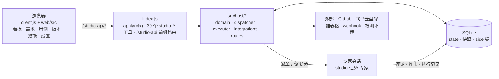

# dsh-studio

[](https://github.com/marsken88/dsh-studio/actions/workflows/ci.yml)
[](https://www.npmjs.com/package/@marsken/dsh-studio)
[](https://www.npmjs.com/package/@marsken/dsh-studio)
[](LICENSE)


给一家公司用的「需求&任务工作空间」：一个常驻的 DSH 插件，把**看板 + 角色 agent + 内部市场**装进 DSH Web 的同一个页面里。
自建 GitLab 管代码、飞书管交流，agent 负责产品 / 架构 / 研发 / 测试四个角色的具体活儿。

运行环境：DSH `0.2.2-rc.1`，Node 22 以上，Linux/macOS（Windows 原生不支持 `link:` 安装 + systemd 托管）。

维护：供应链数字化组。有问题在本仓库开 issue，或直接找看板里的「产品」；发版流程见 [docs/publish.md](docs/publish.md)。

## 功能地图

按「一条需求从生到死」的顺序排，细节见各专题文档；实现流水账在 [docs/history.md](docs/history.md)。

| 阶段 | 能力 |
| --- | --- |
| 需求 | 统一编号、功能点拆解、可追溯矩阵、待确认清单、RICE 需求池、变更历史 |
| 澄清 | 拆卡前的必答项与门禁（`src/host/discovery.js`），答不全不许开工 |
| 设计 | 设计评审记录 + 进开发前的闸门（`src/host/design.js`） |
| 执行 | 一卡一会话、一卡一 worktree；自动派单给产品/架构/研发/测试四类专家 |
| 用例 | 接口 / shell / 数据库三种执行器；跨卡用例总览；失败自动开缺陷卡 |
| 准出 | 卡片与需求两级准出、验收清单、覆盖矩阵、人工签字 |
| 发布 | 版本 tag、灰度与部署记录、冒烟清单、发布门禁 |
| 观测 | 工作台（在办/逾期/阻塞/缺陷）、效能（周期分布/返工/AI 成本）、燃尽 |
| 集成 | GitLab（MR 事实对账）、飞书（云文档/多维表格/webhook）、内部市场 |

## 界面与组件

前端是单文件产物 `client.js`，界面组件统一走 **BoardUI** 的官方源码（MIT，原样引入，见 `web/src/components/base/**`），
自有样式只在 `web/src/index.css` 与 `web/src/boardui/**` 两处补位。

- 组件清单与取舍理由：[docs/ui.md](docs/ui.md)
- 本地打过补丁的 vendored 文件只有两处（`notification.tsx` / `toast.tsx` 的 `container`），清单同样在 `docs/ui.md`

## 它是怎么跑的



一句话：**浏览器只认 `/studio-api`；状态全在 SQLite；专家是 DSH 会话，写回来的东西也落 SQLite；外部系统只被平台调用。**

## 它长什么样

| 工作台：今天该做什么、谁在忙 | 看板：八列、角色负责人、卡片带进度/用例 |
| --- | --- |
|  |  |

| 卡片抽屉：状态 / 清单 / 用例 / 执行记录 | 需求：基线、变更影响面、可追溯矩阵 |
| --- | --- |
|  |  |

| 用例库：跨卡聚合、套件、最近回归 | 效能：一次通过率、返工率、按专家 + token 成本 |
| --- | --- |
|  |  |

| 版本：发布、灰度、部署记录 | 设置·测试执行：执行开关、数量上限、出站 webhook |
| --- | --- |
|  |  |

| 设置·成本与预算：价目表（元/百万 token） | 设置·专家：8 位专家、模型与提示词 |
| --- | --- |
|  |  |

截图不是手截的：`npm run shots`（`tools/visual/capture.mjs`）会登录面板、逐个页签截一遍，顺手断言没有「渲染失败」。

## 部署

仓库：https://github.com/marsken88/dsh-studio（`main` 分支，含可直接安装的构建产物 `client.js`，clone 下来就能装，不用先构建）。

```bash
# 1) 拉到宿主机
# 1) 拉到本机任意目录
git clone https://github.com/marsken88/dsh-studio.git ~/dsh-studio

# 2) 装进目标 profile（会写 profile 的 package.json + bundles，走 pnpm link）
dsh plugin --profile web add link:~/dsh-studio

# 3) 确认挂载
dsh --profile web --dump-config | grep -A2 'dsh-studio'

# 4) 重启服务
sudo systemctl restart dsh-web
```

页面入口：DSH Web 左侧栏第 4 项「需求&任务工作空间」。三个页签：**看板 / 市场 / 设置**。

## 质量闸门

两类 HTML/CSS 抓不到的回归，现在由构建期守卫和真库自检挡住：

| 命令 | 挡什么 |
| --- | --- |
| `cd web && npm run guard` | CSS 里写回 `hsl(var(--x))`（颜色解析失败）、Radix Portal 忘记 `container={portalRoot()}`（弹层「存在但不可见」）、产物丢失门户作用域属性 |
| `npm run smoke:store -- ~/.dsh/dsh-studio.db` | 用生产库的 `.db/-wal/-shm` 副本在本地跑真实启动路径，抓「空库能起、真库就炸」的 `ReferenceError` |
| `npm test` | 102 条契约：manifest、产物哈希、宿主接口、跨模块导入、只读绑定赋值、迁移与文档一致性、门禁纯函数、快捷键解析 |

`pnpm build` 已串上守卫（`make-legacy → guard --pre → vite build → sync-client → guard --post`），CI 也会跑：忘记构建或写出上面两类样式，流水线直接红。

## 门禁链（从澄清到发布）

平台不是「拖过去就算完」：每一步都有东西看着，**拦的只有必须在场的东西，其余一律只提示**——提示多了会被无视，拦多了会被绕过。

| 阶段 | 检查 | 拦不拦 |
| --- | --- | --- |
| 澄清 | 三问必答（有没有服务端 / 鉴权谁做 / 交付边界） | **拦**：答不完拆不了卡 |
| 拆卡 | 说有后端，但功能点没有一条讲接口 / 数据表 / 鉴权 | 提示 |
| 拆卡 | 说没有后端，功能点却要建表 / 写接口 | 提示 |
| 拆卡 | 功能点没有验收标准（长不出用例） | 提示 |
| 卡准出 | 清单没勾完 / 有用例失败 / 卡被标阻塞 / 没人签字 | **拦**（`override` 可强推，须写原因并留痕） |
| 需求准出 | 没有产品输出 / 评审没过 / 有待确认问题 / 卡没完成 / 卡在阻塞 / 缺陷未关 / 用例失败 / **一条跑过的用例都没有** / 没签字 | **拦** |
| 需求准出 | **卡上没有产品/架构专家的讨论**（只有自动跑用例的汇总）、RICE 没打分、功能点没被通过用例覆盖、**有用例没跑过**、**有用例被标跳过**、**「通过」是手标的没有执行记录**、**有卡是强推的**、没有交付物 | 提示 |
| 发布 | tag 名、关联卡、冒烟清单 | **拦** |

> 需求签字前会先算准出门禁；确实要提前签就传 `override` 写一句原因，原因会出现在需求准出里——**逃生舱可以开，但要留痕**。
> 新加一条门禁或一条体检，必须同时进 `npm run selfcheck`（连跑三轮的闭环断言），否则它只是写在代码里的建议。

## 更多文档

| 想了解 | 看这里 |
| --- | --- |
| 登录与免登录（LDAP / 本地超管 / 会话落库） | [docs/auth.md](docs/auth.md) |
| 界面实现（shadcn 对齐 / 构建链 / 布局一致性 / 暗色巡检） | [docs/ui.md](docs/ui.md) |
| 第一天上手（三条命令，全新 clone 验过） | [docs/quickstart.md](docs/quickstart.md) |
| 发版到插件市场 | [docs/publish.md](docs/publish.md) |
| 宿主接口依赖与升级 runbook | [docs/compatibility.md](docs/compatibility.md) |
| 过程记录（按日期的实现流水账） | [docs/history.md](docs/history.md) |
| 每个版本改了什么 | [CHANGELOG.md](CHANGELOG.md) |

## 开发与兼容性

- 参与开发（构建链、部署、验证要求、禁区）：[AGENTS.md](AGENTS.md)
更新日志（每版改了什么、有哪些已知限制）：[CHANGELOG.md](CHANGELOG.md)
上手第一天（三条命令，已在全新 clone 上验证过）：[docs/quickstart.md](docs/quickstart.md)
发布到插件市场（npm / GitHub 发版 + 收录条目 + 自查清单）：[docs/publish.md](docs/publish.md)
- 依赖的 dsh 宿主接口、升级 runbook、兼容矩阵与已知限制：[docs/compatibility.md](docs/compatibility.md)

## 已知限制

- 上下文**构成占比**（工具 / 助手 / 输入）是按会话日志文本体积估算的，不是引擎账目：宿主把 `sessionProjections` 暴露给了插件，`tokenMeasurement` 就是引擎计量，但 `stateOf()` 要**活会话对象**，只能在派单收尾时取——还没接（调研结论见 `docs/history.md`）。**占用率已经是真实数据**（用 `request/context` 的 `contextWindow`）。
- 多维表格镜像是**手动触发**的（`POST /studio-api/feishu/mirror`，支持 `dryRun` 先看会写多少条）：一条记录 = 一张卡，200 条一批串行写；表里要有「编号 / 标题 / 状态 / 负责人 / 优先级 / 需求 / 更新时间」这几列。**还没在真实表格上验证成功路径**——本机 lark-cli 未完成用户授权时，它会如实返回 authorization 错误而不是假成功。
- GitLab 同步 Issue 与**关联 MR**（`/issues/:iid/related_merge_requests`）；卡上挂 MR 后「从 GitLab 核对」会拉 MR 详情、`/changes` 与 `/pipelines`（流水线状态进 `coding.gitlab`）。**不同步 MR 的评论**；MR 的合并/关闭状态要等下一次同步才反映到卡上。
- 用例记录存在卡上（`task.cases`）：跨卡的**用例总览**页签可以勾选批量跑（结果回写各自卡、失败照旧开缺陷），也支持**回归套件**（`/suite/*`：按规则或手选固定一批，一键重跑，`by` 记「套件：名字」）。但还没有「回归套件」这个对象——固定的用例集合、一键重跑、历次通过率趋势都还没有，批量跑是临时勾选、跑完即散。
- 缺陷卡的严重级别默认 `P2`、优先级 `normal`：自动建卡不猜严重程度，由人或在评论里改。
- 派单失败会记在 `/studio-api/integrations` 与卡片抽屉里，并按 `agentRetryPlan` **自动重试**（间隔递增、有上限）；超过上限才挂阻塞等人。
- 集成健康现在会**落盘保留最近一次结果**（SQLite 的 `meta:side:integration-health`，不进 state、不涨 revision、不占快照）：重启 dsh-web 后四条通道不再回到「还没用过」。仍然只是「最近一次」，没有按小时/按天的长期趋势（要趋势还得上采集）。
- 工具层权限只认会话名（`studio-<taskId>-<expertId>`）：如果哪个 agent 用了别的会话名，就会被当成「名单外」拦下写操作，需要在审计里看一眼。
- 同一张卡在同一列只自动派一次（防止来回循环），需要再跑一轮就点「马上处理」，或在评论里 `@` 它。
- 并发上限是全局的（设置 → 自动派单 → 同时最多几个 agent，默认 2）：名额满了新卡就排队，把在跑的会话停掉或把上限调大即可。
- 删掉卡片会自动收回它占用的名额（原来会留一个幽灵会话把并发名额占死，已修）。
- 专家团是「团长 + @ 接棒」的协作模式；2026-11-13 起有**团级记忆**：卡推进到「完成」时自动记一条（做了什么、遗留什么），派活时把这个团最近 5 条塞进专家提示词；0.1.24 起**同一条经验出现 ≥2 次会提炼成「这次先规避」的约束**（记忆里反复踩的坑才会变成硬提示），避免同一批人反复踩同一个坑。记忆存在 SQLite 的 side 键里，最多每个团 20 条，可在「设置 → 专家团」里清空。
- 新写或改写的技能对**已经开着的会话**不立即生效（技能目录在会话开始时枚举），开新会话或下一次派单即可看到。
- 「从链接拉飞书正文」与「产物归档到飞书云盘」都依赖宿主机的 `lark-cli` 与有效的用户授权；`auth status` 里 user 不是 ready 时页面会提示，按提示重新授权即可。
- 归档出来的是云盘里的 Markdown 文件，不是飞书在线文档：同事能打开、能下载、能被搜索，但不能在线协同编辑与评论；正文由平台覆盖更新，人工在飞书上改的内容下次覆盖会丢。
- 归档是同步写：一次要写很多产物时（比如批量补历史）会挨个调 `lark-cli`，几十份文档需要十几秒到几十秒。
- 需求基线是快照：可以**逐行对比**「基线 vs 最新 PRD」（只读，`web/src/studio/diff.js` 的 LCS），也**可以回滚到基线**——
  回滚是实质变更：正文回到基线那一版、文档版本号 +1、原来的验收签字作废，并在文档历史里留一条「PRD 回滚」（谁回滚的、从哪一版）。
  「设为基线 / 对比基线 / 回滚到基线 / 取消基线」四个入口都在需求详情的「文档与基线」里；需求的评审仍是人工点按钮，没有独立审批流。
- 「从链接拉正文」支持飞书的 docx / wiki 链接（走宿主机 `lark-cli docs +fetch`，飞书云盘的 `file/` 链接会明确被拒）；
  拉回来的正文可以直接设为基线。这一步 2026-11-17 在一篇真实 wiki 文档上验过（标题与 1715 字正文都拿到了）。
- AI Coding 执行记录由 agent/人登记；卡上挂了 MR 后「从 GitLab 核对」（`/coding/gitlab`）会拉 MR 详情、`/changes`（改动文件清单 + 提交数）、
  `/commits`（逐条提交）与流水线做事实比对：**自报的每个提交都要按 sha 前缀在 MR 里找得到**，对不上的单独列在抽屉里，不静默覆盖。
  流水线有测试报告时（`/pipelines/:id/test_report`）还会比自报的单测数；仓库没产出报告就退一步数 job 成败（那是任务数，不跟单测数比）。
  仍缺：CI 产物本身（构建物、报告文件）不下载，只记数字；真实 `git.lyf.com` 令牌还没接通，这条链目前用 `tools/mock-gitlab.mjs` 打桩验过。
- 「业务负责人」与「期望完成」是可选项：没填时抽屉里显示「未指派」/「未排期」，不是数据丢失；需要时补上再点「保存改动」。

## 许可证

Apache-2.0，见 [LICENSE](LICENSE)。仓库里不含公司数据，配置示例里的地址 / token / 主机名都是占位值。

